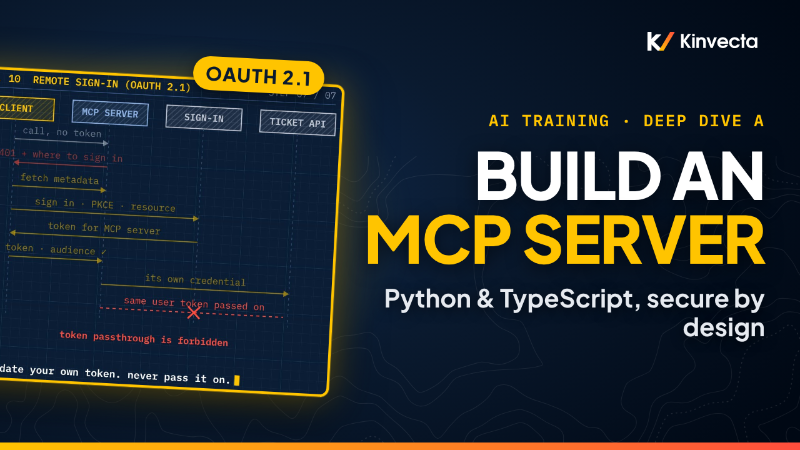

# Deep Dive A · Build an MCP server from scratch

   

**Length:** 20:30 · **For:** Builders · **Classroom version:** 120 minutes

The Model Context Protocol (MCP) changed in July 2026, and most tutorials are now out of date. In this deep dive from the Kinvecta AI training series, we build a small MCP server, ticket-desk, from scratch on the current spec and the version-two SDKs, and we build it the DevSecOps way: security at every step, not bolted on at the end.

## What you'll learn

- How MCP works: host, client and server, and the trust boundaries between them
- What a request looks like on the wire today (spec 2026-07-28: no handshake, no sessions, server/discover)
- Tools, resources and prompts, and who controls each one
- The anatomy of a tool definition, and why descriptions must be reviewed like code
- A read-only tool in Python, where type hints become the schema
- An action that asks a person first, and the decline-and-cancel bug to avoid (Python and TypeScript)
- stdio vs Streamable HTTP, and where a server should run: local, remote, or in a container behind a firewall
- Testing with the MCP Inspector, and snapshotting the tool list in CI
- Connecting to Claude Desktop, Claude Code and VS Code
- Remote sign-in with OAuth 2.1, and why token passthrough is forbidden
- Real threats (tool poisoning, rug pulls, injection in results, malicious packages, DNS rebinding) and the server-side control for each
- A DevSecOps loop for the whole life of a server

## Rule of thumb

> **Few tools, tight schemas. A person confirms every action. Validate your own token. Never pass it on.**

## Chapters

- 0:00 Welcome: build a server you can trust
- 0:37 What you'll be able to do
- 1:11 Why build it carefully
- 2:05 Host, client, server
- 2:59 The big picture: four layers, three trust boundaries
- 3:52 Tools, resources and prompts
- 4:34 Anatomy of a tool definition
- 5:12 One request on the wire today
- 6:03 Set up on the current SDKs
- 6:54 Python: a read-only tool in 16 lines
- 8:04 Python: an action that asks a person first
- 9:01 How the server asks: multi-round-trip requests
- 9:59 TypeScript: the decline fix
- 10:51 stdio vs Streamable HTTP
- 12:01 Where an MCP server runs
- 12:50 Build, inspect, break, fix
- 13:42 Connect it to a host
- 14:31 OAuth 2.1, and why no token passthrough
- 15:44 Threats and server-side controls
- 16:58 DevSecOps for an MCP server
- 17:54 The rule of thumb
- 18:10 Hands-on lab
- 19:23 Check your understanding
- 20:11 Next: containers, scanning and the CI/CD pipeline (Deep Dive B)

## Key ideas

- The MCP spec changed on 28 July 2026: no start-up handshake or sessions, and every request carries its own protocol version. Both official SDKs moved to version 2 with renamed APIs, so older tutorials are legacy.
- Three roles (host, client, server) and four layers with trust boundaries. Each layer enforces its own rules, and results always travel back as data.
- Tools, resources and prompts are controlled by the model, the app and the user. In a tool definition, the model reads the name and description, the SDK enforces the schema, and annotations are only hints.
- Actions ask a person first via a multi-round-trip request. Always handle no and cancel, or the server loops.
- stdio for one person, Streamable HTTP behind a gateway for teams, containers with an egress allow-list in production. Remote sign-in is OAuth 2.1; never pass the user's token on.
- Test like a reviewer (Inspector, the decline path, a tool-list snapshot gate in CI) and treat it as a DevSecOps loop: design, build, test, secure, ship, operate.

## Key terms

| Term | Meaning |
|---|---|
| Host | The AI app the person uses. It runs the model, asks for consent and enforces policy. |
| Client | A connector inside the host. Each client talks to exactly one server. |
| Server | The program that exposes tools, resources and prompts. It acts with your authority, so it is where safety is enforced. |
| Tool | An action or lookup the model decides to call, for example `get_ticket`. |
| Resource | Read-only data with an address that the app attaches as context, for example `tickets://TCK-1001`. |
| Prompt | A named template the user picks, usually shown as a slash command. |
| Input schema | The JSON Schema for a tool's arguments. The SDK enforces it before your code runs. |
| Annotations | Hints such as `readOnlyHint` or `destructiveHint`. Hosts may use them for the interface, but they enforce nothing. |
| Elicitation | The server asking the person for input in the middle of a call, for example a confirmation form. |
| Multi-round-trip request | How a server asks today: it returns an input-required result, the client asks the person and retries the call with the answer and a new request ID. |
| stdio | Local transport. The host spawns the server as a child process; standard out carries only protocol messages, so logs go to standard error. |
| Streamable HTTP | Remote transport: one `POST /mcp` per message, with headers that must match the body. Replaces the older HTTP plus server-sent events transport. |
| `server/discover` | The request every server must answer with its supported protocol versions and capabilities. Clients may call it first. |
| Token passthrough | Forwarding the token a client sent to a downstream API. The spec forbids it; the server validates the audience and uses its own credential. |
| Tool poisoning | Hidden instructions in a tool description that change what the model does. Review descriptions like code and snapshot the tool list. |
| Rug pull | A tool that was approved as safe later changes its definition. Pin versions and treat any tool-list change as a change-control event. |
| DNS rebinding | A web page tricking the browser into reaching a local HTTP server. Bind to localhost and allow-list Host headers. |

## Check your understanding

Pause and answer in your own words, then open the answer.

1. With no start-up handshake, how does a server learn the client's protocol version?

From the metadata on every request, which carries the protocol version and the client's capabilities. Clients may also call `server/discover` first.

2. Your stdio server works by hand, but the host says it failed. Why?

Something wrote to standard out (a print or `console.log`), corrupting the protocol stream. Log to standard error, and check absolute paths and environment variables in the host config.

3. <code>destructiveHint</code> is false. Can the host auto-approve the tool on that basis?

No. Annotations are untrusted hints and enforce nothing. Enforcement is the server's authorization, scopes and confirmation.

4. Why must a server never forward the token it received?

That's token passthrough, which the spec forbids. The token is meant for the MCP server, so forwarding it bypasses downstream controls, breaks the audit trail and turns the server into an exfiltration proxy. Use the server's own credential.

5. How does a server get a person's confirmation in the middle of a call?

It returns an input-required result with a confirmation form. The client asks the person and retries the call with the answer and a new request ID.

6. Name two controls against a malicious or changed server.

Any two of: pin exact versions and digests, install from verified publishers or an internal mirror, snapshot and diff the tool list in CI, restrict outbound network access, least-privilege tokens.

## Further reading

- [MCP specification, revision 2026-07-28](https://modelcontextprotocol.io/specification/2026-07-28): the current protocol, including the stateless design and `server/discover`
- [MCP security best practices](https://modelcontextprotocol.io/specification/latest/basic/security_best_practices): confused deputy, token passthrough, SSRF, state handles and local-server risks
- [MCP authorization](https://modelcontextprotocol.io/specification/latest/basic/authorization): OAuth 2.1 for remote servers, protected-resource metadata and scopes
- [MCP Inspector](https://modelcontextprotocol.io/docs/tools/inspector): web, CLI and terminal clients, CI recipes and where it stores secrets
- [Connect to local MCP servers](https://modelcontextprotocol.io/docs/develop/connect-local-servers): host configuration and troubleshooting, using Claude Desktop as the example
- [OWASP Top 10 for Agentic Applications (2026)](https://genai.owasp.org/resource/owasp-top-10-for-agentic-applications-for-2026/): tool misuse, privilege abuse, agentic supply chain and unexpected code execution

## In this folder

| File | What it is |
|---|---|
| [`slides.pdf`](slides.pdf) | The slides from the video, one page per slide |
| [`transcript/Deep Dive A - Build an MCP Server from Scratch - transcript.txt`](transcript/Deep%20Dive%20A%20-%20Build%20an%20MCP%20Server%20from%20Scratch%20-%20transcript.txt) | The narration as text, with chapter times |
| [`lab/`](lab/) | The ticket-desk MCP server in Python and TypeScript, with tests |
| [`lab/exercises.md`](lab/exercises.md) | Guided exercises that extend ticket-desk: a search tool, the decline path, a tool-list snapshot gate |
| [`lab/starter.py`](lab/starter.py) | An empty server to start Part A of the lab from, if you want to type the tools yourself |

Watch the whole series in order in the [YouTube playlist](https://www.youtube.com/playlist?list=PLQqgikRVyDAM). [Back to the course](../README.md#course) · [Versión en español](../es/Inmersi%C3%B3n%20t%C3%A9cnica%20A%20-%20Construye%20un%20servidor%20MCP%20desde%20cero/)
