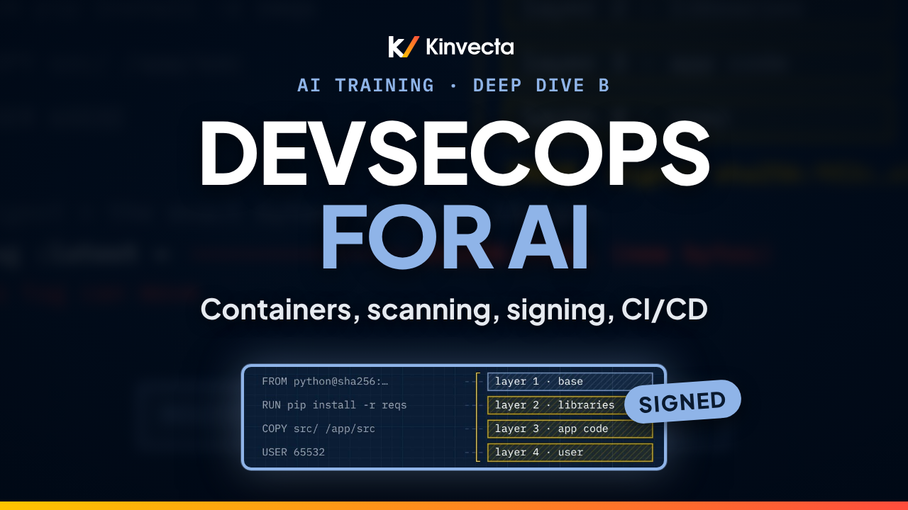

# Deep Dive B · Deep dive B: DevSecOps: containers, scanning and CI/CD

   

**Length:** 19:41 · **For:** Builders and reviewers · **Classroom version:** 120 minutes

How do you ship software you can actually trust, and keep trusting it? This deep dive from the Kinvecta AI training series walks through DevSecOps for AI workloads end to end: what a container really is, where containers run, how to harden an image, where secrets belong, how scanning and triage work, how signing proves you shipped the same box you scanned, how the CI/CD pipeline enforces it all, and how firewalls fence it in, in both directions.

## What you'll learn

- DevSecOps: security in every stage, not one gate at the end (shift left, keep watching right)
- Images, containers, registries, and why the digest, not the tag, is the true identity
- Where containers run: laptop, single server, serverless containers, Kubernetes, edge and air-gapped, and who patches what
- How to harden a Dockerfile: minimal pinned base, multi-stage build, no secrets, non-root user
- Where secrets live: never in the image or repo; secrets managers, OIDC workload identity and runtime injection
- The kinds of scanning (secrets, SAST, SCA, IaC, image, SBOM, DAST) and the open-source and commercial tools for each
- Triage that works: KEV first, then EPSS, then fixable criticals, with VEX for what doesn't apply
- Signing, attestations and admission control (Cosign, SBOM, provenance, Kyverno)
- A real GitHub Actions pipeline, annotated, and why you pin actions by full commit SHA
- Firewalls and network controls: WAF, cloud firewalls, host firewalls, the Docker/ufw gotcha, NetworkPolicy and egress allow-lists
- AI-specific gates: pinned models and prompts, evals, MCP/skill scanning and egress control

## Rule of thumb

> **Pin everything. Scan before it ships. Sign it, and ship the same digest.**

## Chapters

- 0:00 Welcome: one box, trusted everywhere
- 0:33 What you'll be able to do
- 0:56 Three problems a good pipeline solves
- 1:33 DevSecOps: security in every stage
- 2:19 Image, container, registry and digest
- 3:06 Where containers run
- 4:05 Hardening the image
- 4:52 Reading a hardened Dockerfile
- 6:00 Where secrets live
- 6:58 A scanner at every station
- 7:47 Scanning tools by category
- 8:57 Triage: fix what's exploited first
- 10:01 Sign, attest, verify
- 10:52 Signing, registry, admission and runtime tools
- 11:51 The CI/CD line and its gates
- 12:41 A GitHub Actions pipeline, annotated
- 13:44 When the scanner is the attack
- 14:31 Firewalls: default deny, both directions
- 15:27 Network layers and the tools for each
- 16:42 AI-specific gates
- 17:23 The rule of thumb
- 17:38 Exercise: find the problems, then triage
- 18:27 Check your understanding
- 19:22 Wrap-up: build it, box it, ship it

## In this folder

| File | What it is |
|---|---|
| [`slides.pdf`](slides.pdf) | The slides from the video, one page per slide |
| [`transcript/Deep Dive B - DevSecOps Containers, Scanning and CI-CD - transcript.txt`](transcript/Deep%20Dive%20B%20-%20DevSecOps%20Containers%2C%20Scanning%20and%20CI-CD%20-%20transcript.txt) | The narration as text, with chapter times |
| [`research-brief.md`](research-brief.md) | The research brief behind the session, with sources |

Watch the whole series in order in the [YouTube playlist](https://www.youtube.com/playlist?list=PLQqgikRVyDAM). [Back to the course](../README.md#course) · [Versión en español](../es/Inmersi%C3%B3n%20t%C3%A9cnica%20B%20-%20DevSecOps%2C%20contenedores%2C%20escaneo%20y%20el%20pipeline%20de%20CI-CD/)
