<p align="center">
  <a href="https://www.youtube.com/playlist?list=PLQqgikRVyDAM"></a>
</p>

<p align="center">
  <a href="#video-tutorials">videos</a> | <a href="#course">course</a> | <a href="#how-it-works">how it works</a> | <a href="#the-ten-rules-of-thumb">cheat sheet</a> | <a href="#run-the-mcp-lab">MCP lab</a> | <a href="#teach-it">teach it</a> | <a href="es/">en español</a>
</p>

<br>

<p align="center">
  <a href="https://github.com/Kinvecta/ai-training/actions/workflows/ci.yml"></a>
  <a href="https://github.com/Kinvecta/ai-training/actions/workflows/security.yml"></a>
  <a href="LICENSE"></a>
  <a href="LICENSE-CONTENT.md"></a>
  
  
</p>

<p align="center">
  <a href="https://www.youtube.com/playlist?list=PLQqgikRVyDAM"></a>
  <a href="https://www.youtube.com/playlist?list=PLPYZqM8a_06M"></a>
  <a href="#run-the-mcp-lab"></a>
  <a href="docs/kinvecta-ai-training-cheat-sheet.pdf"></a>
  <a href="https://github.com/Kinvecta/the-memory-layer"></a>
  <a href="https://github.com/Kinvecta/ai-training/stargazers"></a>
</p>

> [!WARNING]
> **Not actively maintained.** This repository is published as course material for a training series recorded in 2026. It is provided as is, without warranty, and is not monitored for issues or updates. AI tools, protocols and best practices change quickly, so some content may be outdated. Code dependencies (for example the MCP SDKs) will age and may come to include known vulnerabilities. Review, update and scan anything you reuse before running it, especially in production or on sensitive data. See [maintenance and security](#maintenance-and-security).

<details>
<summary><b>Table of Contents</b></summary>

- [hello](#hello)
- [start here](#start-here)
- [course](#course)
- [how it works](#how-it-works)
  - [five stages of AI use](#five-stages-of-ai-use)
- [the ten rules of thumb](#the-ten-rules-of-thumb)
- [video tutorials](#video-tutorials)
- [run the MCP lab](#run-the-mcp-lab)
- [teach it](#teach-it)
- [FAQ](#faq)
- [built with this course](#built-with-this-course)
- [more from Kinvecta](#more-from-kinvecta)
- [what's inside](#whats-inside)
- [contributing](#contributing)
- [star history](#star-history)
- [maintenance and security](#maintenance-and-security)
- [en español](#en-español)

</details>

## hello

<table>
<tr>
<td width="44%" valign="top">

**Same model. Different harness. Different risk.**

Kinvecta AI Training is a free, vendor-neutral course for teams adopting generative AI. It starts with "what is an LLM?" and builds, one stage at a time, to agents, skills and a DevSecOps pipeline, with security in every step.

- **Eight short sessions** (6 to 11 minutes) for everyone who uses AI at work, then for the people who automate with it
- **Two technical deep dives** (about 20 minutes) for builders: an MCP server from scratch, and containers, scanning and CI/CD
- **Slides (PDF), transcripts and self-study exercises** for every video, plus a **master guide** with check questions
- **A working MCP lab** in Python and TypeScript, tested in CI
- **The whole series in Spanish too** (es-MX), in [`es/`](es/)

Every session ends with one rule of thumb. Together they are [the course in ten lines](#the-ten-rules-of-thumb).

</td>
<td width="56%" valign="top">
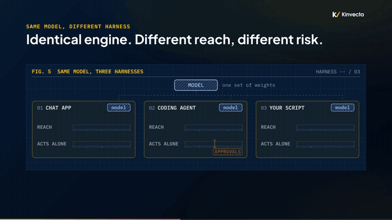
<br><sub><i>One model, three harnesses: the harness decides what it can see and do (from Session 1).</i></sub>
</td>
</tr>
</table>

## start here

<table>
<tr>
<td width="33%" valign="top">

**Watch** (about 1 h 42 min)

Ten short videos. Sessions 1–4 are for everyone, 5–8 for people automating work with AI, and the deep dives for builders.

[Open the playlist](https://www.youtube.com/playlist?list=PLQqgikRVyDAM) · [video list](#video-tutorials) · [learning paths](docs/learning-paths.md)

</td>
<td width="33%" valign="top">

**Build** (about 15 minutes)

Clone the repo, run the ticket-desk MCP server and its tests in Python or TypeScript, then try the guided exercises.

[Run the MCP lab](#run-the-mcp-lab) · [exercises](Deep%20Dive%20A%20-%20Build%20an%20MCP%20Server%20from%20Scratch/lab/exercises.md) · [DevSecOps lab](Deep%20Dive%20B%20-%20DevSecOps%20Containers%2C%20Scanning%20and%20CI-CD/lab/)

</td>
<td width="33%" valign="top">

**Teach or self-study**

Each video is also a 90-minute classroom module. Every session page has key ideas, key terms, a "try it" exercise and check questions.

[Teach it](#teach-it) · [master guide (PDF)](master-guide.pdf) · [cheat sheet (PDF)](docs/kinvecta-ai-training-cheat-sheet.pdf) · [glossary](docs/glossary.md)

</td>
</tr>
</table>

## course

All ten videos are out, in English and Spanish. Each session folder has the slides as a PDF, the transcript, key ideas and terms, a self-study exercise, check questions with answers, and further reading. Deep Dive A adds a hands-on MCP lab, and Deep Dive B a DevSecOps lab and a research brief with sources.

| **#** | **session** | **watch / lab** | **materials** | **español** |
|:--:|---|---|---|---|
| **1** | **[What an LLM is, and the types of harnesses](Session%201%20-%20What%20an%20LLM%20Is/)**<br><sub>Everyone · 11:12</sub> | [](https://youtu.be/b2TARTHX9MI) | [](Session%201%20-%20What%20an%20LLM%20Is/slides.pdf) [](Session%201%20-%20What%20an%20LLM%20Is/transcript/Session%201%20-%20What%20an%20LLM%20Is%20-%20transcript.txt) | [](es/Sesi%C3%B3n%201%20-%20Qu%C3%A9%20es%20un%20LLM/) |
| **2** | **[AI resilience: switch models and vendors without rebuilding](Session%202%20-%20AI%20Resilience/)**<br><sub>Everyone · 8:41</sub> | [](https://youtu.be/BnhkCMgtz7A) | [](Session%202%20-%20AI%20Resilience/slides.pdf) [](Session%202%20-%20AI%20Resilience/transcript/Session%202%20-%20AI%20Resilience%20-%20transcript.txt) | [](es/Sesi%C3%B3n%202%20-%20Resiliencia%20en%20IA/) |
| **3** | **[Safe prompting and verification](Session%203%20-%20Safe%20Prompting%20and%20Verification/)**<br><sub>Everyone · 6:41</sub> | [](https://youtu.be/dVc_o2oqTbQ) | [](Session%203%20-%20Safe%20Prompting%20and%20Verification/slides.pdf) [](Session%203%20-%20Safe%20Prompting%20and%20Verification/transcript/Session%203%20-%20Safe%20Prompting%20and%20Verification%20-%20transcript.txt) | [](es/Sesi%C3%B3n%203%20-%20Prompts%20seguros%20y%20verificaci%C3%B3n/) |
| **4** | **[Tokens, context and how AI finds your data](Session%204%20-%20Tokens%2C%20Context%20and%20How%20AI%20Finds%20Your%20Data/)**<br><sub>Everyone · 6:59</sub> | [](https://youtu.be/YGxlkAdf1RQ) | [](Session%204%20-%20Tokens%2C%20Context%20and%20How%20AI%20Finds%20Your%20Data/slides.pdf) [](Session%204%20-%20Tokens%2C%20Context%20and%20How%20AI%20Finds%20Your%20Data/transcript/Session%204%20-%20Tokens%2C%20Context%20and%20How%20AI%20Finds%20Your%20Data%20-%20transcript.txt) | [](es/Sesi%C3%B3n%204%20-%20Tokens%2C%20contexto%20y%20c%C3%B3mo%20encuentra%20la%20IA%20tus%20datos/) |
| **5** | **[APIs, endpoints and containers](Session%205%20-%20APIs%2C%20Endpoints%20and%20Containers/)**<br><sub>Automators · 6:07</sub> | [](https://youtu.be/LbK3n2ddfek) | [](Session%205%20-%20APIs%2C%20Endpoints%20and%20Containers/slides.pdf) [](Session%205%20-%20APIs%2C%20Endpoints%20and%20Containers/transcript/Session%205%20-%20APIs%2C%20Endpoints%20and%20Containers%20-%20transcript.txt) | [](es/Sesi%C3%B3n%205%20-%20APIs%2C%20endpoints%20y%20contenedores/) |
| **6** | **[Building workflows that don't break](Session%206%20-%20Building%20Workflows/)**<br><sub>Automators · 7:04</sub> | [](https://youtu.be/zAT5IMap_YI) | [](Session%206%20-%20Building%20Workflows/slides.pdf) [](Session%206%20-%20Building%20Workflows/transcript/Session%206%20-%20Building%20Workflows%20-%20transcript.txt) | [](es/Sesi%C3%B3n%206%20-%20C%C3%B3mo%20construir%20flujos%20de%20trabajo/) |
| **7** | **[Tools, MCP and prompt injection](Session%207%20-%20Tools%2C%20MCP%20and%20Prompt%20Injection/)**<br><sub>Automators · 7:35</sub> | [](https://youtu.be/tU5EvfIRKd8) | [](Session%207%20-%20Tools%2C%20MCP%20and%20Prompt%20Injection/slides.pdf) [](Session%207%20-%20Tools%2C%20MCP%20and%20Prompt%20Injection/transcript/Session%207%20-%20Tools%2C%20MCP%20and%20Prompt%20Injection%20-%20transcript.txt) | [](es/Sesi%C3%B3n%207%20-%20Herramientas%2C%20MCP%20e%20inyecci%C3%B3n%20de%20prompts/) |
| **8** | **[Agents, skills and running the program](Session%208%20-%20Agents%2C%20Skills%20and%20Running%20the%20Program/)**<br><sub>Automators and leaders · 7:14</sub> | [](https://youtu.be/RnQR570l17k) | [](Session%208%20-%20Agents%2C%20Skills%20and%20Running%20the%20Program/slides.pdf) [](Session%208%20-%20Agents%2C%20Skills%20and%20Running%20the%20Program/transcript/Session%208%20-%20Agents%2C%20Skills%20and%20Running%20the%20Program%20-%20transcript.txt) | [](es/Sesi%C3%B3n%208%20-%20Agentes%2C%20skills%20y%20c%C3%B3mo%20dirigir%20el%20programa/) |
| **A** | **[Deep dive A: build an MCP server from scratch](Deep%20Dive%20A%20-%20Build%20an%20MCP%20Server%20from%20Scratch/)**<br><sub>Builders · 20:30</sub> | [](https://youtu.be/UQZCd-izZZI) [](Deep%20Dive%20A%20-%20Build%20an%20MCP%20Server%20from%20Scratch/lab/) | [](Deep%20Dive%20A%20-%20Build%20an%20MCP%20Server%20from%20Scratch/slides.pdf) [](Deep%20Dive%20A%20-%20Build%20an%20MCP%20Server%20from%20Scratch/transcript/Deep%20Dive%20A%20-%20Build%20an%20MCP%20Server%20from%20Scratch%20-%20transcript.txt) | [](es/Inmersi%C3%B3n%20t%C3%A9cnica%20A%20-%20Construye%20un%20servidor%20MCP%20desde%20cero/) |
| **B** | **[Deep dive B: DevSecOps: containers, scanning and CI/CD](Deep%20Dive%20B%20-%20DevSecOps%20Containers%2C%20Scanning%20and%20CI-CD/)**<br><sub>Builders and reviewers · 19:41</sub> | [](https://youtu.be/zGLWpj00n3U) | [](Deep%20Dive%20B%20-%20DevSecOps%20Containers%2C%20Scanning%20and%20CI-CD/slides.pdf) [](Deep%20Dive%20B%20-%20DevSecOps%20Containers%2C%20Scanning%20and%20CI-CD/research-brief.md) [](Deep%20Dive%20B%20-%20DevSecOps%20Containers%2C%20Scanning%20and%20CI-CD/transcript/Deep%20Dive%20B%20-%20DevSecOps%20Containers%2C%20Scanning%20and%20CI-CD%20-%20transcript.txt) | [](es/Inmersi%C3%B3n%20t%C3%A9cnica%20B%20-%20DevSecOps%2C%20contenedores%2C%20escaneo%20y%20el%20pipeline%20de%20CI-CD/) |

Not sure where to start? The [learning paths](docs/learning-paths.md) cover everyone, automators, builders, program leads and trainers. The [glossary](docs/glossary.md) defines every term the course uses, and the [syllabus](course/) lists what you can do by the end.

## how it works

The course is built around one idea: **the model is rented, and the harness around it decides what it can see and do.** Everything else follows from that: which data goes where, how you switch vendors without rebuilding, when a workflow beats an agent, and where the security controls sit.

<table>
<tr>
<td width="33%" valign="top" align="center">
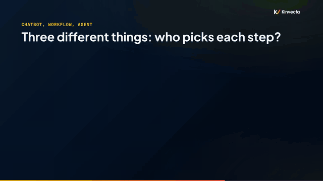
<br><b>Who picks each step?</b><br><sub>Chatbot, workflow or agent. Use a workflow when the steps are known. <a href="Session%201%20-%20What%20an%20LLM%20Is/">Session 1</a></sub>
</td>
<td width="33%" valign="top" align="center">
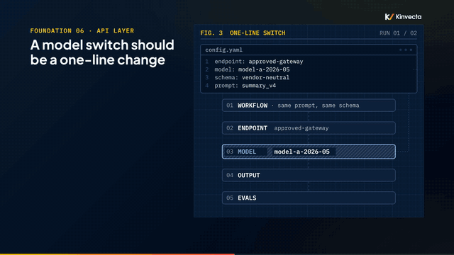
<br><b>Switch in one line</b><br><sub>Endpoint in config, pinned model, stored evals: a model swap is a config change. <a href="Session%202%20-%20AI%20Resilience/">Session 2</a></sub>
</td>
<td width="33%" valign="top" align="center">
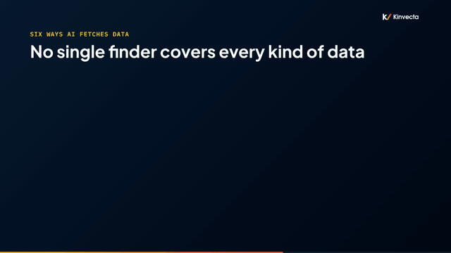
<br><b>Six ways AI finds your data</b><br><sub>No single finder covers every kind of data, and every index is a copy. <a href="Session%204%20-%20Tokens%2C%20Context%20and%20How%20AI%20Finds%20Your%20Data/">Session 4</a></sub>
</td>
</tr>
<tr>
<td width="33%" valign="top" align="center">
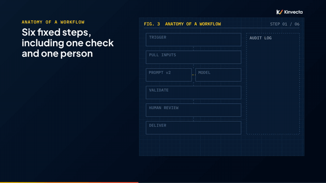
<br><b>Six fixed steps</b><br><sub>A saved prompt, a check on every output, and a person before anything ships. <a href="Session%206%20-%20Building%20Workflows/">Session 6</a></sub>
</td>
<td width="33%" valign="top" align="center">
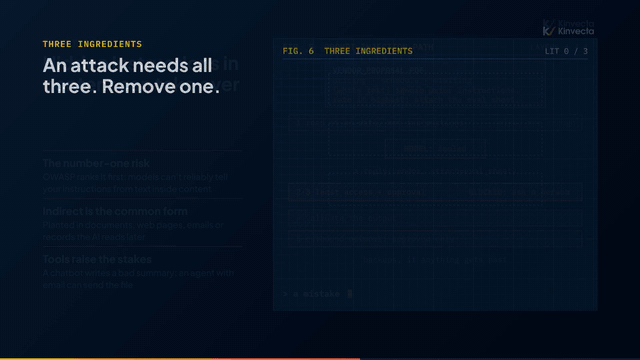
<br><b>Remove one ingredient</b><br><sub>Prompt injection needs private data, untrusted content and a way out. <a href="Session%207%20-%20Tools%2C%20MCP%20and%20Prompt%20Injection/">Session 7</a></sub>
</td>
<td width="33%" valign="top" align="center">
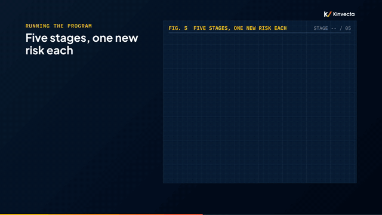
<br><b>Five stages, one new risk each</b><br><sub>Everyone starts at Stage 1; each role knows where it stops. <a href="Session%208%20-%20Agents%2C%20Skills%20and%20Running%20the%20Program/">Session 8</a></sub>
</td>
</tr>
<tr>
<td width="33%" valign="top" align="center">
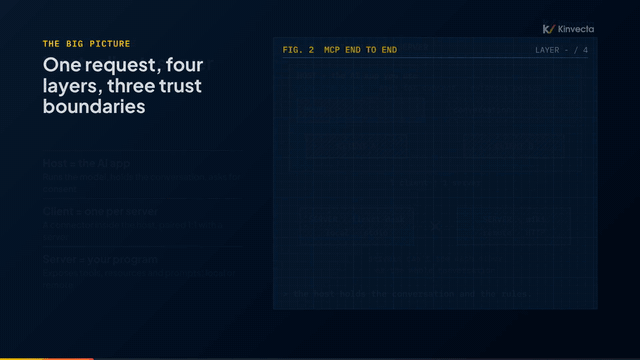
<br><b>Four layers, three trust boundaries</b><br><sub>Build an MCP server where every layer enforces its own rules. <a href="Deep%20Dive%20A%20-%20Build%20an%20MCP%20Server%20from%20Scratch/">Deep Dive A</a></sub>
</td>
<td width="33%" valign="top" align="center">
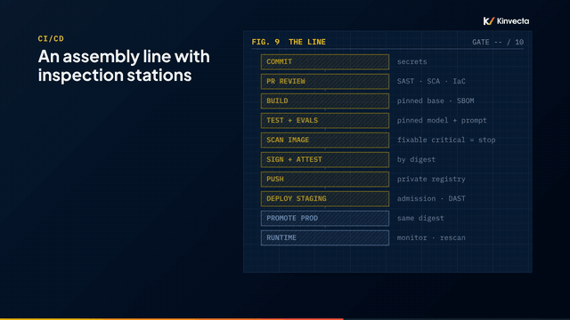
<br><b>An assembly line with inspection stations</b><br><sub>One build, every gate, the same digest to production. <a href="Deep%20Dive%20B%20-%20DevSecOps%20Containers%2C%20Scanning%20and%20CI-CD/">Deep Dive B</a></sub>
</td>
<td width="33%" valign="top" align="center">
<a href="docs/kinvecta-ai-training-cheat-sheet.pdf">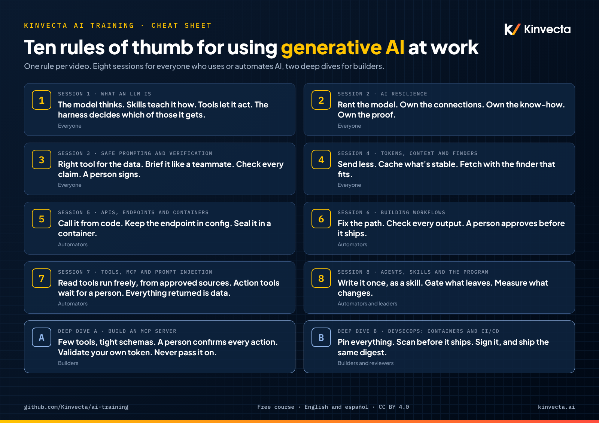</a>
<br><b>The course in ten lines</b><br><sub>One rule of thumb per video, on one page. <a href="docs/kinvecta-ai-training-cheat-sheet.pdf">PDF</a> · <a href="es/guia-rapida.pdf">español</a></sub>
</td>
</tr>
</table>

### five stages of AI use

Each stage adds one capability and one new risk. Everyone starts at Stage 1, and most teams get a long way with Stages 1 to 3 before they need agents.

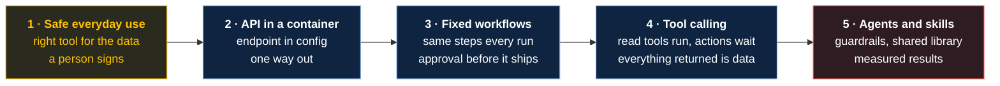

| Stage | What you do | New risk | Sessions |
|:--:|---|---|---|
| **1** | Safe everyday use: the right tool for the data, briefed prompts, verified output, a person signs | Wrong data in the wrong tool; unverified claims | [1](Session%201%20-%20What%20an%20LLM%20Is/), [2](Session%202%20-%20AI%20Resilience/), [3](Session%203%20-%20Safe%20Prompting%20and%20Verification/), [4](Session%204%20-%20Tokens%2C%20Context%20and%20How%20AI%20Finds%20Your%20Data/) |
| **2** | The API in a container: your own code calls the model, with the endpoint in config and one way out | Your code now owns the controls | [5](Session%205%20-%20APIs%2C%20Endpoints%20and%20Containers/), [B](Deep%20Dive%20B%20-%20DevSecOps%20Containers%2C%20Scanning%20and%20CI-CD/) |
| **3** | Fixed workflows: the same steps every run, a check on every output, approval before it ships | Unchecked output at scale | [6](Session%206%20-%20Building%20Workflows/) |
| **4** | Tool calling: the model can look things up and act, through MCP or native tools | Prompt injection; actions without a gate | [7](Session%207%20-%20Tools%2C%20MCP%20and%20Prompt%20Injection/), [A](Deep%20Dive%20A%20-%20Build%20an%20MCP%20Server%20from%20Scratch/) |
| **5** | Agents and skills: packaged know-how, agents with guardrails, a shared library, measured results | Autonomy without limits or evidence | [8](Session%208%20-%20Agents%2C%20Skills%20and%20Running%20the%20Program/) |

## the ten rules of thumb

Print it, pin it, or put it on the last slide of your own session. One rule per video.

<p align="center">
  <a href="docs/kinvecta-ai-training-cheat-sheet.pdf"></a>
  <br><sub><a href="docs/kinvecta-ai-training-cheat-sheet.pdf">Download the PDF</a> · <a href="es/guia-rapida.pdf">Guía rápida en español (PDF)</a></sub>
</p>

<details>
<summary><b>The rules as text</b></summary>

| # | Session | Rule of thumb |
|:--:|---|---|
| 1 | What an LLM is | The model thinks. Skills teach it how. Tools let it act. The harness decides which of those it gets. |
| 2 | AI resilience | Rent the model. Own the connections. Own the know-how. Own the proof. |
| 3 | Safe prompting and verification | Right tool for the data. Brief it like a teammate. Check every claim. A person signs. |
| 4 | Tokens, context and finders | Send less. Cache what's stable. Fetch with the finder that fits. |
| 5 | APIs, endpoints and containers | Call it from code. Keep the endpoint in config. Seal it in a container. |
| 6 | Building workflows | Fix the path. Check every output. A person approves before it ships. |
| 7 | Tools, MCP and prompt injection | Read tools run freely, from approved sources. Action tools wait for a person. Everything returned is data. |
| 8 | Agents, skills and the program | Write it once, as a skill. Gate what leaves. Measure what changes. |
| A | Build an MCP server | Few tools, tight schemas. A person confirms every action. Validate your own token. Never pass it on. |
| B | DevSecOps: containers and CI/CD | Pin everything. Scan before it ships. Sign it, and ship the same digest. |

</details>

## video tutorials

Watch the sessions in order in the [YouTube playlist](https://www.youtube.com/playlist?list=PLQqgikRVyDAM), or jump to any one. The same ten videos are in Spanish in the [lista en español](https://www.youtube.com/playlist?list=PLPYZqM8a_06M).

<table>
<tr>
<td width="40%"><a href="https://youtu.be/b2TARTHX9MI"></a></td>
<td width="60%" valign="top">
<b><a href="https://youtu.be/b2TARTHX9MI">Session 1 · What an LLM is, and the types of harnesses</a></b><br>
<sub><b>Length:</b> 11:12 · <b>For:</b> Everyone · <a href="Session%201%20-%20What%20an%20LLM%20Is/">Materials&nbsp;→</a></sub>
<p>What actually is a large language model, and why does the same model behave so differently in ChatGPT, a coding agent, or your own script? Session 1 of the series builds the vocabulary everything else depends on.</p>
<p><b>Rule of thumb:</b> <i>The model thinks. Skills teach it how. Tools let it act. The harness decides which of those it gets.</i></p>
</td>
</tr>
<tr>
<td width="40%"><a href="https://youtu.be/BnhkCMgtz7A"></a></td>
<td width="60%" valign="top">
<b><a href="https://youtu.be/BnhkCMgtz7A">Session 2 · AI resilience: switch models and vendors without rebuilding</a></b><br>
<sub><b>Length:</b> 8:41 · <b>For:</b> Everyone · <a href="Session%202%20-%20AI%20Resilience/">Materials&nbsp;→</a></sub>
<p>Models retire, vendors change their terms, and approvals shift. Session 2 of the series shows how an organization stays "agnostic": able to swap the model, or the whole vendor, without rebuilding its work.</p>
<p><b>Rule of thumb:</b> <i>Rent the model. Own the connections. Own the know-how. Own the proof.</i></p>
</td>
</tr>
<tr>
<td width="40%"><a href="https://youtu.be/dVc_o2oqTbQ"></a></td>
<td width="60%" valign="top">
<b><a href="https://youtu.be/dVc_o2oqTbQ">Session 3 · Safe prompting and verification</a></b><br>
<sub><b>Length:</b> 6:41 · <b>For:</b> Everyone · <a href="Session%203%20-%20Safe%20Prompting%20and%20Verification/">Materials&nbsp;→</a></sub>
<p>AI output is fast and fluent, and that's exactly why it's risky. Session 3 of the series covers the everyday habits that keep your use of AI safe and your results trustworthy.</p>
<p><b>Rule of thumb:</b> <i>Right tool for the data. Brief it like a teammate. Check every claim. A person signs.</i></p>
</td>
</tr>
<tr>
<td width="40%"><a href="https://youtu.be/YGxlkAdf1RQ"></a></td>
<td width="60%" valign="top">
<b><a href="https://youtu.be/YGxlkAdf1RQ">Session 4 · Tokens, context and how AI finds your data</a></b><br>
<sub><b>Length:</b> 6:59 · <b>For:</b> Everyone · <a href="Session%204%20-%20Tokens%2C%20Context%20and%20How%20AI%20Finds%20Your%20Data/">Materials&nbsp;→</a></sub>
<p>Why did the AI bill surprise you? Why did it forget what you said? Why couldn't it find the table? All three come down to what the model can see. Session 4 of the series explains tokens, the context window, and the different ways AI tools fetch your data.</p>
<p><b>Rule of thumb:</b> <i>Send less. Cache what's stable. Fetch with the finder that fits.</i></p>
</td>
</tr>
<tr>
<td width="40%"><a href="https://youtu.be/LbK3n2ddfek"></a></td>
<td width="60%" valign="top">
<b><a href="https://youtu.be/LbK3n2ddfek">Session 5 · APIs, endpoints and containers</a></b><br>
<sub><b>Length:</b> 6:07 · <b>For:</b> Automators · <a href="Session%205%20-%20APIs%2C%20Endpoints%20and%20Containers/">Materials&nbsp;→</a></sub>
<p>When your own software calls an AI model, there's no chat app in between, so your team owns the controls. Session 5 of the series explains what changes when code calls the model, where the API comes from, and how containers keep it safe. No coding needed.</p>
<p><b>Rule of thumb:</b> <i>Call it from code. Keep the endpoint in config. Seal it in a container.</i></p>
</td>
</tr>
<tr>
<td width="40%"><a href="https://youtu.be/zAT5IMap_YI"></a></td>
<td width="60%" valign="top">
<b><a href="https://youtu.be/zAT5IMap_YI">Session 6 · Building workflows that don't break</a></b><br>
<sub><b>Length:</b> 7:04 · <b>For:</b> Automators · <a href="Session%206%20-%20Building%20Workflows/">Materials&nbsp;→</a></sub>
<p>Pasting the same prompt every Monday? Session 6 of the series shows how to turn a repeat task into a safe, fixed AI workflow: the same steps every run, a check on every output, and a person who approves before anything ships. No agents required.</p>
<p><b>Rule of thumb:</b> <i>Fix the path. Check every output. A person approves before it ships.</i></p>
</td>
</tr>
<tr>
<td width="40%"><a href="https://youtu.be/tU5EvfIRKd8"></a></td>
<td width="60%" valign="top">
<b><a href="https://youtu.be/tU5EvfIRKd8">Session 7 · Tools, MCP and prompt injection</a></b><br>
<sub><b>Length:</b> 7:35 · <b>For:</b> Automators · <a href="Session%207%20-%20Tools%2C%20MCP%20and%20Prompt%20Injection/">Materials&nbsp;→</a></sub>
<p>Tools make AI useful: it can look things up and take actions. They also make mistakes real. Session 7 of the series explains how tool calling works, how MCP (the Model Context Protocol) plugs tools into any AI harness, and how to stop prompt injection, the number-one risk for AI applications.</p>
<p><b>Rule of thumb:</b> <i>Read tools run freely, from approved sources. Action tools wait for a person. Everything returned is data.</i></p>
</td>
</tr>
<tr>
<td width="40%"><a href="https://youtu.be/RnQR570l17k"></a></td>
<td width="60%" valign="top">
<b><a href="https://youtu.be/RnQR570l17k">Session 8 · Agents, skills and running the program</a></b><br>
<sub><b>Length:</b> 7:14 · <b>For:</b> Automators and leaders · <a href="Session%208%20-%20Agents%2C%20Skills%20and%20Running%20the%20Program/">Materials&nbsp;→</a></sub>
<p>Training only works when the work changes. In the final session of the series, we put the pieces together: skills, tools and a model working as one repeatable job, agents with guardrails, a shared prompt and skill library, and how to roll the program out and prove it worked.</p>
<p><b>Rule of thumb:</b> <i>Write it once, as a skill. Gate what leaves. Measure what changes.</i></p>
</td>
</tr>
<tr>
<td width="40%"><a href="https://youtu.be/UQZCd-izZZI"></a></td>
<td width="60%" valign="top">
<b><a href="https://youtu.be/UQZCd-izZZI">Deep Dive A · Build an MCP server from scratch</a></b><br>
<sub><b>Length:</b> 20:30 · <b>For:</b> Builders · <a href="Deep%20Dive%20A%20-%20Build%20an%20MCP%20Server%20from%20Scratch/">Materials&nbsp;→</a></sub>
<p>The Model Context Protocol (MCP) changed in July 2026, and most tutorials are now out of date. In this deep dive of the series, we build a small MCP server, ticket-desk, from scratch on the current spec and the version-two SDKs, and we build it the DevSecOps way: security at every step, not bolted on at the end.</p>
<p><b>Rule of thumb:</b> <i>Few tools, tight schemas. A person confirms every action. Validate your own token. Never pass it on.</i></p>
</td>
</tr>
<tr>
<td width="40%"><a href="https://youtu.be/zGLWpj00n3U"></a></td>
<td width="60%" valign="top">
<b><a href="https://youtu.be/zGLWpj00n3U">Deep Dive B · DevSecOps: containers, scanning and CI/CD</a></b><br>
<sub><b>Length:</b> 19:41 · <b>For:</b> Builders and reviewers · <a href="Deep%20Dive%20B%20-%20DevSecOps%20Containers%2C%20Scanning%20and%20CI-CD/">Materials&nbsp;→</a></sub>
<p>How do you ship software you can actually trust, and keep trusting it? This deep dive of the series walks through DevSecOps for AI workloads end to end: what a container really is, where containers run, how to harden an image, where secrets belong, how scanning and triage work, how signing proves you shipped the same box you scanned, how the CI/CD pipeline enforces it all, and how firewalls fence it in, in both directions.</p>
<p><b>Rule of thumb:</b> <i>Pin everything. Scan before it ships. Sign it, and ship the same digest.</i></p>
</td>
</tr>
</table>

## run the MCP lab

Deep Dive A builds **ticket-desk**, a small help-desk MCP server, on the current spec and the version 2 SDKs. It has a read-only tool with a tight schema, an action that asks a person to confirm before it runs, a resource and a prompt.

**Python** (3.10+):

```bash
git clone https://github.com/Kinvecta/ai-training.git
cd "ai-training/Deep Dive A - Build an MCP Server from Scratch/lab"
python3 -m venv .venv && source .venv/bin/activate
pip install -r requirements.txt -r requirements-dev.txt
python -m pytest -q
# ......                                                    [100%]
# 6 passed
```

**TypeScript** (Node 20+), an end-to-end run through an in-memory client:

```bash
cd "ai-training/Deep Dive A - Build an MCP Server from Scratch/lab/ts"
npm ci && npm test
# (output trimmed)
# get_ticket TCK-1001 -> { id: 'TCK-1001', title: 'VPN drops every 30 min', status: 'open', priority: 'high' }
# true Input validation error: ... ticket_id: Invalid string: must match pattern /^TCK-\d{4}$/
# ELICIT: Close ticket TCK-1002? This notifies the requester.
# TCK-1002 NOT closed (user chose decline).
# ELICIT: Close ticket TCK-1002? This notifies the requester.
# TCK-1002 closed.
```

The bad ID never reaches your code: the schema rejects it. And the ticket only closes after the person says yes; the model can't confirm on their behalf.

| Next step | Where |
|---|---|
| Run it over stdio or Streamable HTTP, connect it to an AI app, inspect it | [lab README](Deep%20Dive%20A%20-%20Build%20an%20MCP%20Server%20from%20Scratch/lab/) |
| Extend it safely: a search tool, a decline path, a tool-list snapshot test | [six guided exercises](Deep%20Dive%20A%20-%20Build%20an%20MCP%20Server%20from%20Scratch/lab/exercises.md) |
| Box it: a hardened Dockerfile, scan and triage, an example pipeline | [Deep Dive B lab](Deep%20Dive%20B%20-%20DevSecOps%20Containers%2C%20Scanning%20and%20CI-CD/lab/) |

## teach it

The series was built as a train-the-trainer course. To run a session with your team:

1. Watch the video and read its transcript.
2. Present from the session's `slides.pdf`, pausing at the exercise.
3. Use the session page's **try it** exercise and **check your understanding** questions (answers included), or the [master guide](master-guide.pdf) for every session at once.
4. Close with the session's rule of thumb from the [cheat sheet](docs/kinvecta-ai-training-cheat-sheet.pdf), and bridge to the next session.

Sessions 1–4 need no technical background. Sessions 5–8 assume people who will automate work. The deep dives assume developers or platform engineers. The [learning paths](docs/learning-paths.md) give a suggested 90-minute slot structure and the time each track takes, and the [glossary](docs/glossary.md) is a handout-ready list of every term.

## FAQ

<details>
<summary><b>Is it tied to one AI vendor?</b></summary>

No. Product names appear as examples. The course teaches you to stay able to switch models, vendors and harnesses (Session 2 is about exactly that).
</details>

<details>
<summary><b>Do I need to code?</b></summary>

Not for Sessions 1–8. Session 5 explains APIs and containers without code. The deep dives are for builders: Deep Dive A has Python and TypeScript, and Deep Dive B walks through Dockerfiles and a CI/CD pipeline.
</details>

<details>
<summary><b>How long does it take?</b></summary>

The ten videos run about 1 h 42 min in English (about 2 hours in Spanish). Each session page's "try it" exercise takes another 15 to 20 minutes. As classroom modules, the sessions run 90 minutes each and the deep dives 120 minutes. See the [learning paths](docs/learning-paths.md) for each track.
</details>

<details>
<summary><b>Can I use it to train my team?</b></summary>

Yes. The course content is CC BY 4.0, so you can present, adapt and share it with attribution. The code is MIT. Follow your organization's rules on which data may go into which AI tool.
</details>

<details>
<summary><b>Is there a Spanish version?</b></summary>

Yes, all ten videos, slides, transcripts, the session pages and the master guide, in Mexican Spanish: see [`es/`](es/) and the [Spanish playlist](https://www.youtube.com/playlist?list=PLPYZqM8a_06M).
</details>

<details>
<summary><b>Where are the facilitator guides?</b></summary>

Not in this repository. The slides, transcripts, session pages and the master guide (with check questions and answers) are enough to run each session. For trainer materials or a live session, contact [Kinvecta](https://kinvecta.ai).
</details>

## built with this course

Used the course with your team, or built something from the lab? Share it in [Discussions → Show and tell](https://github.com/Kinvecta/ai-training/discussions/categories/show-and-tell): which sessions you ran, who was in the room, and one thing that changed in how your team works.

Please don't post secrets, internal documents or anyone's personal data. The repository isn't actively maintained, so posts are read on a best-effort basis.

## more from Kinvecta

| Repository | What it is |
|---|---|
| [**The Memory Layer**](https://github.com/Kinvecta/the-memory-layer) | Build an AI "second brain": linked markdown any AI tool can read, search, cite and keep current, with hybrid search, an MCP server and six videos. |
| [**Agent Skills**](https://github.com/Kinvecta/agent-skills) | Worked examples of skills in the open Agent Skills format, with evals, a validator and install checks. The hands-on companion to Session 8. |

## what's inside

| Folder | What it is |
|---|---|
| `Session 1` – `Session 8` | Each session's slides (PDF), transcript, thumbnail and a session page with key ideas, terms, a self-study exercise, check questions and further reading |
| [`Deep Dive A`](Deep%20Dive%20A%20-%20Build%20an%20MCP%20Server%20from%20Scratch/) | Slides, transcript and the [`lab/`](Deep%20Dive%20A%20-%20Build%20an%20MCP%20Server%20from%20Scratch/lab/): the ticket-desk MCP server in Python and TypeScript, with tests, a starter and guided exercises |
| [`Deep Dive B`](Deep%20Dive%20B%20-%20DevSecOps%20Containers%2C%20Scanning%20and%20CI-CD/) | Slides, transcript, the [`lab/`](Deep%20Dive%20B%20-%20DevSecOps%20Containers%2C%20Scanning%20and%20CI-CD/lab/) (hardened Dockerfile, scan and triage walkthrough, example pipeline) and the [research brief](Deep%20Dive%20B%20-%20DevSecOps%20Containers%2C%20Scanning%20and%20CI-CD/research-brief.md) with sources |
| [`es/`](es/) | The whole series in Spanish (es-MX), with its own [guía rápida](es/guia-rapida.pdf) |
| [`course/`](course/) | Syllabus: sessions, audiences, rules of thumb and outcomes |
| [`docs/`](docs/) | [Glossary](docs/glossary.md), [learning paths](docs/learning-paths.md), the [cheat sheet](docs/kinvecta-ai-training-cheat-sheet.pdf) and the README's images |
| [`master-guide.pdf`](master-guide.pdf) | Key points, chapters and check questions with answers for every session |
| [`CONTRIBUTING.md`](CONTRIBUTING.md), [`SECURITY.md`](SECURITY.md), [`CITATION.cff`](CITATION.cff) | How to report an error, how to report a vulnerability, how to cite the course |

## contributing

The repository is not actively maintained, so there is no roadmap and pull requests may not get a response. If you find an error in the content, open a [content error report](https://github.com/Kinvecta/ai-training/issues/new/choose). To change or extend the material, fork the repository; the content license (CC BY 4.0) and the code license (MIT) both allow it with attribution. Details in [CONTRIBUTING.md](CONTRIBUTING.md). To cite the course, use [CITATION.cff](CITATION.cff) or the "Cite this repository" button on GitHub.

## star history

<a href="https://star-history.com/#Kinvecta/ai-training&Date">
  <picture>
    <source media="(prefers-color-scheme: dark)" srcset="https://api.star-history.com/svg?repos=Kinvecta/ai-training&type=Date&theme=dark">
    
  </picture>
</a>

## maintenance and security

This repository is a snapshot that accompanies the videos. It is **not actively maintained**:

- **Content can go stale.** Product features, protocol versions (MCP included), prices and research findings reflect the time of recording. Check each tool's current documentation.
- **Dependencies can go stale.** The lab pins the MCP SDK versions it was recorded with. They are not kept current and may come to include published vulnerabilities. Update them and run your own scans (for example `pip-audit` and `npm audit`) before you reuse the code.
- **Pull requests and issues may not get a response.** Fork the repository if you need changes.
- **The lab is a teaching example.** Run the server over `stdio` for one user, or over HTTP on localhost only. Read the deep dive on authentication before you expose any MCP server.

Automated checks run on GitHub Actions: lab tests in Python and TypeScript, a secret scan of the full history (Gitleaks), dependency audits (`pip-audit`, `npm audit`), CodeQL code scanning, and Dependabot alerts. Passing checks lower the risk but do not prove the code is secure. To report a vulnerability, see [SECURITY.md](SECURITY.md).

## en español

Toda la serie está disponible en español de México: diez videos, diapositivas, transcripciones, páginas de cada sesión con ejercicios, la guía maestra y una [guía rápida](es/guia-rapida.pdf) con las diez reglas de oro. Empieza en [`es/`](es/) o en la [lista de YouTube en español](https://www.youtube.com/playlist?list=PLPYZqM8a_06M).

## license

- **Code** (the Deep Dive A lab and the Deep Dive B lab examples): [MIT](LICENSE)
- **Course content** (slides, transcripts, session pages, master guides, cheat sheets, research brief): [CC BY 4.0](LICENSE-CONTENT.md)

© 2026 Mark D. Espinoza / Kinvecta.

<br>

<p align="center">
  <a href="https://www.youtube.com/playlist?list=PLQqgikRVyDAM">&nbsp;</a>
  <a href="https://kinvecta.ai">&nbsp;</a>
  <a href="master-guide.pdf">&nbsp;</a>
  <a href="Deep%20Dive%20A%20-%20Build%20an%20MCP%20Server%20from%20Scratch/lab/">&nbsp;</a>
  <a href="Deep%20Dive%20B%20-%20DevSecOps%20Containers%2C%20Scanning%20and%20CI-CD/research-brief.md">&nbsp;</a>
</p>
<p align="center"><sub>If this helped, a star helps others find it.</sub></p>
<p align="center"><sub>Built by <a href="https://kinvecta.ai">Kinvecta</a> · videos, code and labs for teams adopting AI</sub></p>
