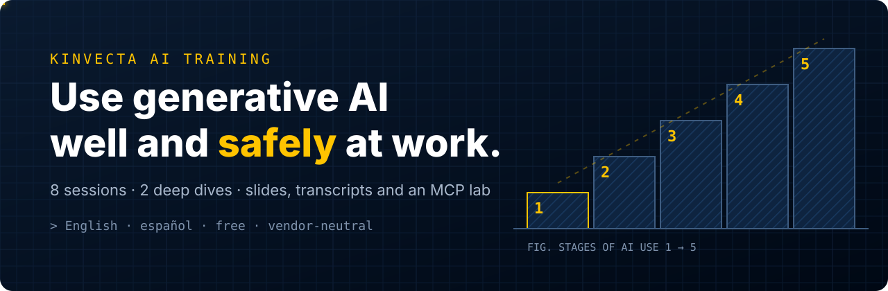

<p align="center">
  <a href="https://www.youtube.com/playlist?list=PLQqgikRVyDAM"></a>
</p>

<p align="center">
  <a href="#video-tutorials">videos</a> | <a href="#course">course</a> | <a href="Deep%20Dive%20A%20-%20Build%20an%20MCP%20Server%20from%20Scratch/lab/">MCP lab</a> | <a href="master-guide.pdf">master guide</a> | <a href="es/">en español</a>
</p>

<br>

<p align="center">
  <a href="https://github.com/Kinvecta/ai-training/actions/workflows/ci.yml"></a>
  <a href="https://github.com/Kinvecta/ai-training/actions/workflows/security.yml"></a>
  <a href="LICENSE"></a>
  <a href="LICENSE-CONTENT.md"></a>
</p>

<p align="center">
  <a href="https://www.youtube.com/playlist?list=PLQqgikRVyDAM"></a>
  <a href="https://www.youtube.com/playlist?list=PLPYZqM8a_06M"></a>
  <a href="Deep%20Dive%20A%20-%20Build%20an%20MCP%20Server%20from%20Scratch/lab/"></a>
  <a href="https://github.com/Kinvecta/ai-training/stargazers"></a>
</p>

> [!WARNING]
> **Not actively maintained.** This repository is published as course material for a training series recorded in 2026. It is provided as is, without warranty, and is not monitored for issues or updates. AI tools, protocols and best practices change quickly, so some content may be outdated. Code dependencies (for example the MCP SDKs) will age and may come to include known vulnerabilities. Review, update and scan anything you reuse before running it, especially in production or on sensitive data. See [maintenance and security](#maintenance-and-security).

<details>
<summary><b>Table of Contents</b></summary>

- [hello](#hello)
- [start here](#start-here)
- [course](#course)
- [video tutorials](#video-tutorials)
- [run the MCP lab](#run-the-mcp-lab)
- [teach it](#teach-it)
- [FAQ](#faq)
- [what's inside](#whats-inside)
- [star history](#star-history)
- [maintenance and security](#maintenance-and-security)
- [en español](#en-español)

</details>

## hello

**Use generative AI well and safely at work.**

Kinvecta AI Training is a free course for teams adopting generative AI. It is vendor-neutral and security-minded, and it goes from "what is an LLM?" to agents, skills and a DevSecOps pipeline, one stage at a time.

- **Eight core sessions** (6 to 11 minutes each) for everyone who uses AI at work, then for the people who automate with it
- **Two technical deep dives** (about 20 minutes each) for builders: an MCP server from scratch, and containers, scanning and CI/CD
- **Slides (PDF) and transcripts** for every video, plus a **master guide** with key points and check questions
- **A working MCP lab** in Python and TypeScript, with tests that run in CI
- **The whole series in Spanish too** (es-MX), in [`es/`](es/)

Every session ends with one rule of thumb. Together they are the course in ten lines.

## start here

<table>
<tr>
<td width="33%" valign="top">

**Watch** (about 1 h 42 min)

Ten short videos. Sessions 1–4 are for everyone, 5–8 for people automating work with AI, and the deep dives for builders.

[Open the playlist](https://www.youtube.com/playlist?list=PLQqgikRVyDAM) · [video list](#video-tutorials)

</td>
<td width="33%" valign="top">

**Build** (about 15 minutes)

Clone the repo and run the ticket-desk MCP server and its tests, in Python or TypeScript.

[Run the MCP lab](#run-the-mcp-lab)

</td>
<td width="33%" valign="top">

**Teach or self-study**

Each video is also a 90-minute classroom module. Use the slides, transcripts and the master guide's check questions.

[Course](#course) · [master guide (PDF)](master-guide.pdf) · [syllabus](course/)

</td>
</tr>
</table>

## course

All ten videos are out, in English and Spanish. Each one has slides as a PDF and a transcript. Deep Dive A adds a hands-on lab, and Deep Dive B a research brief with sources.

| **#** | **session** | **watch / lab** | **materials** | **español** |
|:--:|---|---|---|---|
| **1** | **[What an LLM is, and the types of harnesses](Session%201%20-%20What%20an%20LLM%20Is/)**<br><sub>Everyone · 11:12</sub> | [](https://youtu.be/b2TARTHX9MI) | [](Session%201%20-%20What%20an%20LLM%20Is/slides.pdf) [](Session%201%20-%20What%20an%20LLM%20Is/transcript/Session%201%20-%20What%20an%20LLM%20Is%20-%20transcript.txt) | [](es/Sesi%C3%B3n%201%20-%20Qu%C3%A9%20es%20un%20LLM/) |
| **2** | **[AI resilience: switch models and vendors without rebuilding](Session%202%20-%20AI%20Resilience/)**<br><sub>Everyone · 8:41</sub> | [](https://youtu.be/BnhkCMgtz7A) | [](Session%202%20-%20AI%20Resilience/slides.pdf) [](Session%202%20-%20AI%20Resilience/transcript/Session%202%20-%20AI%20Resilience%20-%20transcript.txt) | [](es/Sesi%C3%B3n%202%20-%20Resiliencia%20en%20IA/) |
| **3** | **[Safe prompting and verification](Session%203%20-%20Safe%20Prompting%20and%20Verification/)**<br><sub>Everyone · 6:41</sub> | [](https://youtu.be/dVc_o2oqTbQ) | [](Session%203%20-%20Safe%20Prompting%20and%20Verification/slides.pdf) [](Session%203%20-%20Safe%20Prompting%20and%20Verification/transcript/Session%203%20-%20Safe%20Prompting%20and%20Verification%20-%20transcript.txt) | [](es/Sesi%C3%B3n%203%20-%20Prompts%20seguros%20y%20verificaci%C3%B3n/) |
| **4** | **[Tokens, context and how AI finds your data](Session%204%20-%20Tokens%2C%20Context%20and%20How%20AI%20Finds%20Your%20Data/)**<br><sub>Everyone · 7:00</sub> | [](https://youtu.be/YGxlkAdf1RQ) | [](Session%204%20-%20Tokens%2C%20Context%20and%20How%20AI%20Finds%20Your%20Data/slides.pdf) [](Session%204%20-%20Tokens%2C%20Context%20and%20How%20AI%20Finds%20Your%20Data/transcript/Session%204%20-%20Tokens%2C%20Context%20and%20How%20AI%20Finds%20Your%20Data%20-%20transcript.txt) | [](es/Sesi%C3%B3n%204%20-%20Tokens%2C%20contexto%20y%20c%C3%B3mo%20encuentra%20la%20IA%20tus%20datos/) |
| **5** | **[APIs, endpoints and containers](Session%205%20-%20APIs%2C%20Endpoints%20and%20Containers/)**<br><sub>Automators · 6:07</sub> | [](https://youtu.be/LbK3n2ddfek) | [](Session%205%20-%20APIs%2C%20Endpoints%20and%20Containers/slides.pdf) [](Session%205%20-%20APIs%2C%20Endpoints%20and%20Containers/transcript/Session%205%20-%20APIs%2C%20Endpoints%20and%20Containers%20-%20transcript.txt) | [](es/Sesi%C3%B3n%205%20-%20APIs%2C%20endpoints%20y%20contenedores/) |
| **6** | **[Building workflows that don't break](Session%206%20-%20Building%20Workflows/)**<br><sub>Automators · 7:04</sub> | [](https://youtu.be/zAT5IMap_YI) | [](Session%206%20-%20Building%20Workflows/slides.pdf) [](Session%206%20-%20Building%20Workflows/transcript/Session%206%20-%20Building%20Workflows%20-%20transcript.txt) | [](es/Sesi%C3%B3n%206%20-%20C%C3%B3mo%20construir%20flujos%20de%20trabajo/) |
| **7** | **[Tools, MCP and prompt injection](Session%207%20-%20Tools%2C%20MCP%20and%20Prompt%20Injection/)**<br><sub>Automators · 7:35</sub> | [](https://youtu.be/tU5EvfIRKd8) | [](Session%207%20-%20Tools%2C%20MCP%20and%20Prompt%20Injection/slides.pdf) [](Session%207%20-%20Tools%2C%20MCP%20and%20Prompt%20Injection/transcript/Session%207%20-%20Tools%2C%20MCP%20and%20Prompt%20Injection%20-%20transcript.txt) | [](es/Sesi%C3%B3n%207%20-%20Herramientas%2C%20MCP%20e%20inyecci%C3%B3n%20de%20prompts/) |
| **8** | **[Agents, skills and running the program](Session%208%20-%20Agents%2C%20Skills%20and%20Running%20the%20Program/)**<br><sub>Automators and leaders · 7:14</sub> | [](https://youtu.be/RnQR570l17k) | [](Session%208%20-%20Agents%2C%20Skills%20and%20Running%20the%20Program/slides.pdf) [](Session%208%20-%20Agents%2C%20Skills%20and%20Running%20the%20Program/transcript/Session%208%20-%20Agents%2C%20Skills%20and%20Running%20the%20Program%20-%20transcript.txt) | [](es/Sesi%C3%B3n%208%20-%20Agentes%2C%20skills%20y%20c%C3%B3mo%20dirigir%20el%20programa/) |
| **A** | **[Deep dive A: build an MCP server from scratch](Deep%20Dive%20A%20-%20Build%20an%20MCP%20Server%20from%20Scratch/)**<br><sub>Builders · 20:30</sub> | [](https://youtu.be/UQZCd-izZZI) [](Deep%20Dive%20A%20-%20Build%20an%20MCP%20Server%20from%20Scratch/lab/) | [](Deep%20Dive%20A%20-%20Build%20an%20MCP%20Server%20from%20Scratch/slides.pdf) [](Deep%20Dive%20A%20-%20Build%20an%20MCP%20Server%20from%20Scratch/transcript/Deep%20Dive%20A%20-%20Build%20an%20MCP%20Server%20from%20Scratch%20-%20transcript.txt) | [](es/Inmersi%C3%B3n%20t%C3%A9cnica%20A%20-%20Construye%20un%20servidor%20MCP%20desde%20cero/) |
| **B** | **[Deep dive B: DevSecOps: containers, scanning and CI/CD](Deep%20Dive%20B%20-%20DevSecOps%20Containers%2C%20Scanning%20and%20CI-CD/)**<br><sub>Builders and reviewers · 19:41</sub> | [](https://youtu.be/zGLWpj00n3U) | [](Deep%20Dive%20B%20-%20DevSecOps%20Containers%2C%20Scanning%20and%20CI-CD/slides.pdf) [](Deep%20Dive%20B%20-%20DevSecOps%20Containers%2C%20Scanning%20and%20CI-CD/research-brief.md) [](Deep%20Dive%20B%20-%20DevSecOps%20Containers%2C%20Scanning%20and%20CI-CD/transcript/Deep%20Dive%20B%20-%20DevSecOps%20Containers%2C%20Scanning%20and%20CI-CD%20-%20transcript.txt) | [](es/Inmersi%C3%B3n%20t%C3%A9cnica%20B%20-%20DevSecOps%2C%20contenedores%2C%20escaneo%20y%20el%20pipeline%20de%20CI-CD/) |

The series follows five stages of AI use: **1** safe everyday use, **2** the API in a container, **3** fixed workflows, **4** tool calling, **5** agents and skills. Everyone starts at Stage 1. The [syllabus](course/) lists every rule of thumb and what you can do by the end.

## video tutorials

Watch the sessions in order in the [YouTube playlist](https://www.youtube.com/playlist?list=PLQqgikRVyDAM), or jump to any one.

<table>
<tr>
<td width="40%"><a href="https://youtu.be/b2TARTHX9MI"></a></td>
<td width="60%" valign="top">
<b><a href="https://youtu.be/b2TARTHX9MI">Session 1 · What an LLM is, and the types of harnesses</a></b><br>
<sub><b>Length:</b> 11:12 · <b>For:</b> Everyone · <a href="Session%201%20-%20What%20an%20LLM%20Is/">Materials&nbsp;→</a></sub>
<p>What actually is a large language model, and why does the same model behave so differently in ChatGPT, a coding agent, or your own script? Session 1 of the series builds the vocabulary everything else depends on.</p>
<p><b>Rule of thumb:</b> <i>The model thinks. Skills teach it how. Tools let it act. The harness decides which of those it gets.</i></p>
</td>
</tr>
<tr>
<td width="40%"><a href="https://youtu.be/BnhkCMgtz7A"></a></td>
<td width="60%" valign="top">
<b><a href="https://youtu.be/BnhkCMgtz7A">Session 2 · AI resilience: switch models and vendors without rebuilding</a></b><br>
<sub><b>Length:</b> 8:41 · <b>For:</b> Everyone · <a href="Session%202%20-%20AI%20Resilience/">Materials&nbsp;→</a></sub>
<p>Models retire, vendors change their terms, and approvals shift. Session 2 of the series shows how an organization stays "agnostic": able to swap the model, or the whole vendor, without rebuilding its work.</p>
<p><b>Rule of thumb:</b> <i>Rent the model. Own the connections. Own the know-how. Own the proof.</i></p>
</td>
</tr>
<tr>
<td width="40%"><a href="https://youtu.be/dVc_o2oqTbQ"></a></td>
<td width="60%" valign="top">
<b><a href="https://youtu.be/dVc_o2oqTbQ">Session 3 · Safe prompting and verification</a></b><br>
<sub><b>Length:</b> 6:41 · <b>For:</b> Everyone · <a href="Session%203%20-%20Safe%20Prompting%20and%20Verification/">Materials&nbsp;→</a></sub>
<p>AI output is fast and fluent, and that's exactly why it's risky. Session 3 of the series covers the everyday habits that keep your use of AI safe and your results trustworthy.</p>
<p><b>Rule of thumb:</b> <i>Right tool for the data. Brief it like a teammate. Check every claim. A person signs.</i></p>
</td>
</tr>
<tr>
<td width="40%"><a href="https://youtu.be/YGxlkAdf1RQ"></a></td>
<td width="60%" valign="top">
<b><a href="https://youtu.be/YGxlkAdf1RQ">Session 4 · Tokens, context and how AI finds your data</a></b><br>
<sub><b>Length:</b> 7:00 · <b>For:</b> Everyone · <a href="Session%204%20-%20Tokens%2C%20Context%20and%20How%20AI%20Finds%20Your%20Data/">Materials&nbsp;→</a></sub>
<p>Why did the AI bill surprise you? Why did it forget what you said? Why couldn't it find the table? All three come down to what the model can see. Session 4 of the series explains tokens, the context window, and the different ways AI tools fetch your data.</p>
<p><b>Rule of thumb:</b> <i>Send less. Cache what's stable. Fetch with the finder that fits.</i></p>
</td>
</tr>
<tr>
<td width="40%"><a href="https://youtu.be/LbK3n2ddfek"></a></td>
<td width="60%" valign="top">
<b><a href="https://youtu.be/LbK3n2ddfek">Session 5 · APIs, endpoints and containers</a></b><br>
<sub><b>Length:</b> 6:07 · <b>For:</b> Automators · <a href="Session%205%20-%20APIs%2C%20Endpoints%20and%20Containers/">Materials&nbsp;→</a></sub>
<p>When your own software calls an AI model, there's no chat app in between, so your team owns the controls. Session 5 of the series explains what changes when code calls the model, where the API comes from, and how containers keep it safe. No coding needed.</p>
<p><b>Rule of thumb:</b> <i>Call it from code. Keep the endpoint in config. Seal it in a container.</i></p>
</td>
</tr>
<tr>
<td width="40%"><a href="https://youtu.be/zAT5IMap_YI"></a></td>
<td width="60%" valign="top">
<b><a href="https://youtu.be/zAT5IMap_YI">Session 6 · Building workflows that don't break</a></b><br>
<sub><b>Length:</b> 7:04 · <b>For:</b> Automators · <a href="Session%206%20-%20Building%20Workflows/">Materials&nbsp;→</a></sub>
<p>Pasting the same prompt every Monday? Session 6 of the series shows how to turn a repeat task into a safe, fixed AI workflow: the same steps every run, a check on every output, and a person who approves before anything ships. No agents required.</p>
<p><b>Rule of thumb:</b> <i>Fix the path. Check every output. A person approves before it ships.</i></p>
</td>
</tr>
<tr>
<td width="40%"><a href="https://youtu.be/tU5EvfIRKd8"></a></td>
<td width="60%" valign="top">
<b><a href="https://youtu.be/tU5EvfIRKd8">Session 7 · Tools, MCP and prompt injection</a></b><br>
<sub><b>Length:</b> 7:35 · <b>For:</b> Automators · <a href="Session%207%20-%20Tools%2C%20MCP%20and%20Prompt%20Injection/">Materials&nbsp;→</a></sub>
<p>Tools make AI useful: it can look things up and take actions. They also make mistakes real. Session 7 of the series explains how tool calling works, how MCP (the Model Context Protocol) plugs tools into any AI harness, and how to stop prompt injection, the number-one risk for AI applications.</p>
<p><b>Rule of thumb:</b> <i>Read tools run freely, from approved sources. Action tools wait for a person. Everything returned is data.</i></p>
</td>
</tr>
<tr>
<td width="40%"><a href="https://youtu.be/RnQR570l17k"></a></td>
<td width="60%" valign="top">
<b><a href="https://youtu.be/RnQR570l17k">Session 8 · Agents, skills and running the program</a></b><br>
<sub><b>Length:</b> 7:14 · <b>For:</b> Automators and leaders · <a href="Session%208%20-%20Agents%2C%20Skills%20and%20Running%20the%20Program/">Materials&nbsp;→</a></sub>
<p>Training only works when the work changes. In the final session of the series, we put the pieces together: skills, tools and a model working as one repeatable job, agents with guardrails, a shared prompt and skill library, and how to roll the program out and prove it worked.</p>
<p><b>Rule of thumb:</b> <i>Write it once, as a skill. Gate what leaves. Measure what changes.</i></p>
</td>
</tr>
<tr>
<td width="40%"><a href="https://youtu.be/UQZCd-izZZI"></a></td>
<td width="60%" valign="top">
<b><a href="https://youtu.be/UQZCd-izZZI">Deep Dive A · Deep dive A: build an MCP server from scratch</a></b><br>
<sub><b>Length:</b> 20:30 · <b>For:</b> Builders · <a href="Deep%20Dive%20A%20-%20Build%20an%20MCP%20Server%20from%20Scratch/">Materials&nbsp;→</a></sub>
<p>The Model Context Protocol (MCP) changed in July 2026, and most tutorials are now out of date. In this deep dive of the series, we build a small MCP server, ticket-desk, from scratch on the current spec and the version-two SDKs, and we build it the DevSecOps way: security at every step, not bolted on at the end.</p>
<p><b>Rule of thumb:</b> <i>Few tools, tight schemas. A person confirms every action. Validate your own token. Never pass it on.</i></p>
</td>
</tr>
<tr>
<td width="40%"><a href="https://youtu.be/zGLWpj00n3U"></a></td>
<td width="60%" valign="top">
<b><a href="https://youtu.be/zGLWpj00n3U">Deep Dive B · Deep dive B: DevSecOps: containers, scanning and CI/CD</a></b><br>
<sub><b>Length:</b> 19:41 · <b>For:</b> Builders and reviewers · <a href="Deep%20Dive%20B%20-%20DevSecOps%20Containers%2C%20Scanning%20and%20CI-CD/">Materials&nbsp;→</a></sub>
<p>How do you ship software you can actually trust, and keep trusting it? This deep dive of the series walks through DevSecOps for AI workloads end to end: what a container really is, where containers run, how to harden an image, where secrets belong, how scanning and triage work, how signing proves you shipped the same box you scanned, how the CI/CD pipeline enforces it all, and how firewalls fence it in, in both directions.</p>
<p><b>Rule of thumb:</b> <i>Pin everything. Scan before it ships. Sign it, and ship the same digest.</i></p>
</td>
</tr>
</table>

## run the MCP lab

Deep Dive A builds **ticket-desk**, a small MCP server with a read-only tool, an action that asks a person to confirm before it runs, a resource and a prompt, on the current spec and the version 2 SDKs.

**Python** (3.10+):

```bash
git clone https://github.com/Kinvecta/ai-training.git
cd "ai-training/Deep Dive A - Build an MCP Server from Scratch/lab"
python3 -m venv .venv && source .venv/bin/activate
pip install -r requirements.txt -r requirements-dev.txt
python -m pytest -q
```

**TypeScript** (Node 20+):

```bash
cd "ai-training/Deep Dive A - Build an MCP Server from Scratch/lab/ts"
npm ci
npm test
```

The [lab README](Deep%20Dive%20A%20-%20Build%20an%20MCP%20Server%20from%20Scratch/lab/) shows how to run the server over stdio or Streamable HTTP and connect it to an AI app.

## teach it

The series was built as a train-the-trainer course. To run a session with your team:

1. Watch the video and read its transcript.
2. Present from the session's `slides.pdf`.
3. Use the [master guide](master-guide.pdf) for each session's key points, chapters and six check questions with model answers.
4. Close with the session's rule of thumb, and bridge to the next session.

Sessions 1–4 need no technical background. Sessions 5–8 assume people who will automate work. The deep dives assume developers or platform engineers.

## FAQ

<details>
<summary><b>Is it tied to one AI vendor?</b></summary>

No. Product names appear as examples. The course teaches you to stay able to switch models, vendors and harnesses (Session 2 is about exactly that).
</details>

<details>
<summary><b>Do I need to code?</b></summary>

Not for Sessions 1–8. Session 5 explains APIs and containers without code. The deep dives are for builders: Deep Dive A has Python and TypeScript, and Deep Dive B walks through Dockerfiles and a CI/CD pipeline.
</details>

<details>
<summary><b>Can I use it to train my team?</b></summary>

Yes. The course content is CC BY 4.0, so you can present, adapt and share it with attribution. The code is MIT. Follow your organization's rules on which data may go into which AI tool.
</details>

<details>
<summary><b>Is there a Spanish version?</b></summary>

Yes, all ten videos, slides, transcripts and the master guide, in Mexican Spanish: see [`es/`](es/) and the [Spanish playlist](https://www.youtube.com/playlist?list=PLPYZqM8a_06M).
</details>

<details>
<summary><b>Where are the facilitator guides?</b></summary>

Not in this repository. The slides, transcripts and the master guide (with check questions and answers) are enough to run each session. For trainer materials or a live session, contact [Kinvecta](https://kinvecta.ai).
</details>

## what's inside

| Folder | What it is |
|---|---|
| `Session 1` – `Session 8` | Each session's slides (PDF), transcript and thumbnail |
| [`Deep Dive A`](Deep%20Dive%20A%20-%20Build%20an%20MCP%20Server%20from%20Scratch/) | Slides, transcript and the [`lab/`](Deep%20Dive%20A%20-%20Build%20an%20MCP%20Server%20from%20Scratch/lab/): the ticket-desk MCP server in Python and TypeScript, with tests |
| [`Deep Dive B`](Deep%20Dive%20B%20-%20DevSecOps%20Containers,%20Scanning%20and%20CI-CD/) | Slides, transcript and the [research brief](Deep%20Dive%20B%20-%20DevSecOps%20Containers%2C%20Scanning%20and%20CI-CD/research-brief.md) with sources |
| [`es/`](es/) | The whole series in Spanish (es-MX) |
| [`course/`](course/) | Syllabus: sessions, audiences, rules of thumb and outcomes |
| [`master-guide.pdf`](master-guide.pdf) | Key points, chapters and check questions with answers for every session |

## star history

<a href="https://star-history.com/#Kinvecta/ai-training&Date">
  <picture>
    <source media="(prefers-color-scheme: dark)" srcset="https://api.star-history.com/svg?repos=Kinvecta/ai-training&type=Date&theme=dark">
    
  </picture>
</a>

## maintenance and security

This repository is a snapshot that accompanies the videos. It is **not actively maintained**:

- **Content can go stale.** Product features, protocol versions (MCP included), prices and research findings reflect the time of recording. Check each tool's current documentation.
- **Dependencies can go stale.** The lab pins the MCP SDK versions it was recorded with. They are not kept current and may come to include published vulnerabilities. Update them and run your own scans (for example `pip-audit` and `npm audit`) before you reuse the code.
- **Pull requests and issues may not get a response.** Fork the repository if you need changes.
- **The lab is a teaching example.** Run the server over `stdio` for one user, or over HTTP on localhost only. Read the deep dive on authentication before you expose any MCP server.

Automated checks run on GitHub Actions: lab tests in Python and TypeScript, a secret scan of the full history (Gitleaks), dependency audits (`pip-audit`, `npm audit`), CodeQL code scanning, and Dependabot alerts. Passing checks lower the risk but do not prove the code is secure. To report a vulnerability, see [SECURITY.md](SECURITY.md).

## en español

Toda la serie está disponible en español de México: diez videos, diapositivas, transcripciones y la guía maestra. Empieza en [`es/`](es/) o en la [lista de YouTube en español](https://www.youtube.com/playlist?list=PLPYZqM8a_06M).

## license

- **Code** (the Deep Dive A lab): [MIT](LICENSE)
- **Course content** (slides, transcripts, master guides, research brief): [CC BY 4.0](LICENSE-CONTENT.md)

© 2026 Mark D. Espinoza / Kinvecta.

<br>

<p align="center">
  <a href="https://www.youtube.com/playlist?list=PLQqgikRVyDAM">&nbsp;</a>
  <a href="https://kinvecta.ai">&nbsp;</a>
  <a href="master-guide.pdf">&nbsp;</a>
  <a href="Deep%20Dive%20A%20-%20Build%20an%20MCP%20Server%20from%20Scratch/lab/">&nbsp;</a>
  <a href="Deep%20Dive%20B%20-%20DevSecOps%20Containers%2C%20Scanning%20and%20CI-CD/research-brief.md">&nbsp;</a>
</p>
<p align="center"><sub>If this helped, a star helps others find it.</sub></p>
<p align="center"><sub>Built by <a href="https://kinvecta.ai">Kinvecta</a> · videos, code and labs for teams adopting AI</sub></p>
