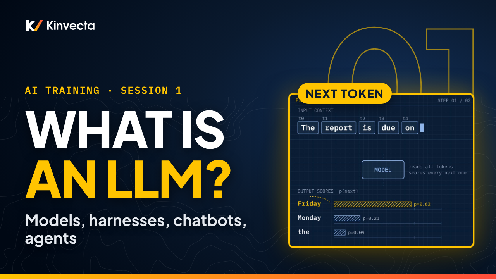

# Session 1 · What an LLM is, and the types of harnesses

  

**Length:** 11:12 · **For:** Everyone · **Classroom version:** 90 minutes

What actually is a large language model, and why does the same model behave so differently in ChatGPT, a coding agent, or your own script? Session 1 of the Kinvecta AI training series builds the vocabulary everything else depends on.

## What you'll learn

- What an LLM is (and isn't): next-token prediction, training, and frozen weights
- Why one request often passes through several models
- The rule of thumb: the model thinks, skills teach it how, tools let it act, and the harness decides which of those it gets
- The six types of harness you'll meet at work, and how to size them up by reach and autonomy
- Where the API comes from: vendor, cloud provider, or approved platform
- The difference between a chatbot, a workflow and an agent: who picks each step?

## Rule of thumb

> **The model thinks. Skills teach it how. Tools let it act. The harness decides which of those it gets.**

## Key ideas

- An LLM is a trained engine that predicts and writes text one token at a time. That one repeated step is why it is so fluent, and why it can be fluently wrong.
- The weights are frozen after training, so the model does not learn from your chats. What apps call "memory" is the harness saving notes and feeding them back in.
- The harness is the software around the model. It decides what the model can see and do, so the same model can be safe in one app and risky in another. Security approves the harness, not just the model.
- To size up any harness, ask two questions: what can it reach, and how much does it act alone? The further up and to the right, the more controls it needs.
- The same model can reach you through three front doors: the vendor's own API, a cloud provider, or an approved platform or gateway. Choose by authorization and data level first, model second.
- Chatbot, workflow, agent: the person picks each step, a designer fixes the steps in advance, or the AI picks steps at run time. If you already know the steps, build a workflow.

## Key terms

| Term | Plain-language meaning |
|---|---|
| Large language model (LLM) | A trained engine that predicts the next piece of text, one token at a time. "Large" means billions of learned settings; "model" means the engine only, not the app around it. |
| Token | The unit of text a model reads and writes, roughly three quarters of a word. |
| Weights | The billions of learned settings inside the model. They are frozen once the model is deployed. |
| Knowledge cutoff | The point after which the model has seen no new text. Anything newer reaches it only if the harness fetches it. |
| Harness | The app or platform wrapped around the model. It adds instructions, memory, permissions, approval gates and logging, and decides what the model can see and do. |
| Skill | Packaged instructions that tell the model how to do a job well. Skills are not training. |
| Tool | A connection that lets the model fetch facts or take actions, often through a standard called MCP. Tools are not "internet access"; the model reaches only what it is connected to. |
| API | A way for your own software to reach the model directly. When that happens, your software becomes the harness. |
| Chatbot, workflow, agent | Three patterns told apart by one question: who picks each step? The person, a designer in advance, or the AI at run time. |
| Reach and autonomy | The two questions to ask of any harness: what can it reach, and how much does it act alone? |

## Try it

About 15 minutes. You need nothing but a notepad.

**Part A: chatbot, workflow or agent? (5 minutes)**

Sort each task below. The test is always the same: who picks each step?

1. Reply to one customer email
2. Summarize every weekly status report to one inbox
3. Find expiring contracts and draft renewal notices
4. Explain a new regulation in plain language
5. Extract invoice fields to a sheet, nightly
6. Find why a nightly report failed and propose a fix
7. Brainstorm names for a new project
8. Translate every incoming form and file it
9. Research three vendors across many sites
10. Rewrite a paragraph for a senior audience

Answer key

Chatbot: 1, 4, 7 and 10. Workflow: 2, 5 and 8. Agent: 3, 6 and 9. If you said "it depends on who picks the steps," you have the idea.

**Part B: inventory one harness (10 minutes)**

Pick one AI tool you use today and answer five questions:

1. Which of the six types is it? (chat assistant, AI built into a tool, org platform or gateway, coding or agent tool, open-source agent, your own software via the API)
2. Which models sit behind it?
3. What can it reach?
4. How much does it act alone?
5. Who approved it, and for what data?

If you cannot answer the last question, that is worth following up on.

## Check your understanding

1. In one sentence, what is a large language model?
   

Answer
A trained engine that predicts and produces text one token at a time.

2. Why can the same model be safe in one app and risky in another?
   

Answer
The harness decides what it can see and do. Security approves the harness, not just the model.

3. Does the model learn from your chats? What is "memory," then?
   

Answer
No. The weights are frozen after training. Memory is the harness saving notes and feeding them back in.

4. Name three types of harness and an example of each.
   

Answer
Any three of the six: chat assistants, AI built into tools, org platforms or gateways, coding and agent tools, open-source agents, your own software via the API.

5. Who picks each step in a chatbot, a workflow and an agent?
   

Answer
The person; a designer, in advance; the AI, at run time.

6. When would you choose a workflow over an agent?
   

Answer
When the steps are known in advance. It's more predictable, and easier to authorize and test.

## Further reading

- [Attention Is All You Need](https://arxiv.org/abs/1706.03762) (Vaswani et al., 2017): the original paper on the transformer architecture behind today's LLMs.
- [Building effective AI agents](https://www.anthropic.com/research/building-effective-agents) (Anthropic): a vendor's primary write-up of the workflow-versus-agent distinction and when each is worth it.
- [Model Context Protocol](https://modelcontextprotocol.io/): the open standard many harnesses use to connect models to tools and data.
- [OWASP Top 10 for LLM Applications: LLM06 Excessive Agency](https://genai.owasp.org/llmrisk/llm062025-excessive-agency/): why reach and autonomy need matching controls.
- [NIST AI Risk Management Framework](https://www.nist.gov/itl/ai-risk-management-framework): a vendor-neutral framework for governing AI systems, including the software around the model.

## Chapters

- 0:00 Welcome
- 0:26 What you'll be able to do
- 0:52 Why vocabulary comes first
- 1:25 What an LLM is
- 2:13 How a model is made
- 2:47 Six beliefs to correct
- 3:29 One request, several models
- 4:04 The rule of thumb
- 4:23 The parts of an AI system
- 5:09 Same model, different harness
- 5:50 Six types of harness
- 6:39 Reach vs. autonomy
- 7:10 Three front doors for the API
- 7:48 Chatbot, workflow, agent
- 8:41 How far your environment lets you go
- 9:15 Exercise
- 10:03 Check your understanding
- 10:32 Next: AI resilience (Session 2)

## In this folder

| File | What it is |
|---|---|
| [`slides.pdf`](slides.pdf) | The slides from the video, one page per slide |
| [`transcript/Session 1 - What an LLM Is - transcript.txt`](transcript/Session%201%20-%20What%20an%20LLM%20Is%20-%20transcript.txt) | The narration as text, with chapter times |

Watch the whole series in order in the [YouTube playlist](https://www.youtube.com/playlist?list=PLQqgikRVyDAM). [Back to the course](../README.md#course) · [Versión en español](../es/Sesi%C3%B3n%201%20-%20Qu%C3%A9%20es%20un%20LLM/)
