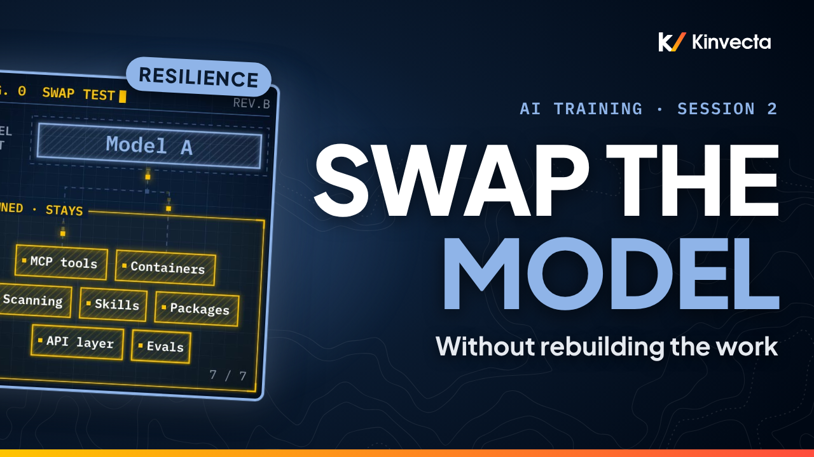

# Session 2 · AI resilience: switch models and vendors without rebuilding

  

**Length:** 8:41 · **For:** Everyone · **Classroom version:** 90 minutes

Models retire, vendors change their terms, and approvals shift. Session 2 of the Kinvecta AI training series shows how an organization stays "agnostic": able to swap the model, or the whole vendor, without rebuilding its work.

## What you'll learn

- What you rent (models, apps, harnesses) vs. what you own
- The four kinds of switch: model version, vendor, endpoint, harness
- The seven foundations an organization owns: approved MCP tools, containers, scanning, skills, code packages, a multi-vendor API layer, and stored evals
- How a model switch becomes a one-line configuration change
- How evals catch model drift and use-case drift
- The switching playbook: no evals, no switch

## Rule of thumb

> **Rent the model. Own the connections. Own the know-how. Own the proof.**

## Chapters

- 0:00 Welcome
- 0:27 What you'll be able to do
- 0:48 Why resilience matters
- 1:15 What "agnostic" means
- 1:51 Four kinds of switch
- 2:24 Four beliefs to correct
- 3:00 Seven foundations, one loop
- 3:50 Seven things you own
- 4:29 The one-line model switch
- 5:06 One skill, many harnesses
- 5:40 Evals catch drift
- 6:17 The rule of thumb
- 6:33 The switching playbook
- 7:05 Exercise: lock-in audit
- 7:43 Check your understanding
- 8:11 Next: safe prompting and verification (Session 3)

## In this folder

| File | What it is |
|---|---|
| [`slides.pdf`](slides.pdf) | The slides from the video, one page per slide |
| [`transcript/Session 2 - AI Resilience - transcript.txt`](transcript/Session%202%20-%20AI%20Resilience%20-%20transcript.txt) | The narration as text, with chapter times |

Watch the whole series in order in the [YouTube playlist](https://www.youtube.com/playlist?list=PLQqgikRVyDAM). [Back to the course](../README.md#course) · [Versión en español](../es/Sesi%C3%B3n%202%20-%20Resiliencia%20en%20IA/)
