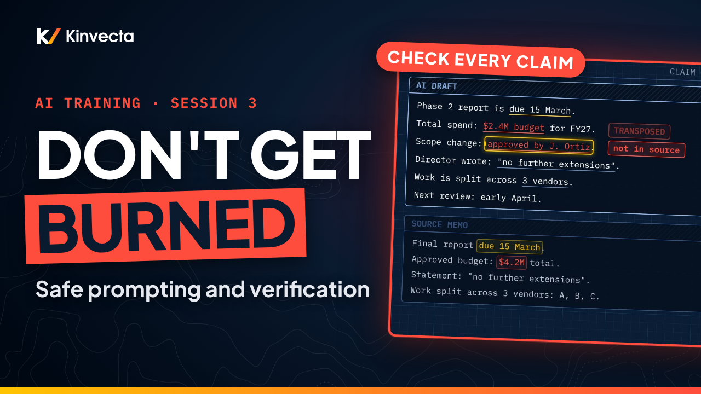

# Session 3 · Safe prompting and verification

  

**Length:** 6:41 · **For:** Everyone · **Classroom version:** 90 minutes

AI output is fast and fluent, and that's exactly why it's risky. Session 3 of the Kinvecta AI training series covers the everyday habits that keep your use of AI safe and your results trustworthy.

## What you'll learn

- The one rule: data only goes into a tool approved for its sensitivity level
- What to do in the first minutes after pasting something you shouldn't have
- Why "AI drafts, a person signs" — accountability, records and responsible use
- How to prompt like you're briefing a new teammate: role, task, audience, format, source
- How to verify a draft claim by claim (and what hallucination looks like in practice)
- How to save a prompt that works as a reviewed, tested instruction

## Rule of thumb

> **Right tool for the data. Brief it like a teammate. Check every claim. A person signs.**

## Key ideas

- Most AI problems at work start with a habit, not the technology. Fluent is not correct, one bad paste can end a program, and vague in means vague out.
- The one rule: data only goes into a tool approved for that data's sensitivity level. If the data and the tool don't match, fix it before you write a single prompt.
- If you paste the wrong thing: stop, report it to your security or privacy contact right away, record what was shared, then follow the incident process. A quiet delete can make it worse.
- Prompt like a briefing: role, task, audience and format, plus the source material. Pasting the source keeps the model working from your material, not its memory.
- Check every claim against the source: sources, numbers, names and dates, quotes, what's missing, and tone and bias. Hallucination in practice is confident, fluent and false.
- AI drafts, a person signs. A prompt that works becomes a saved, reviewed and tested instruction in the team library, and goes back through review when the prompt or model changes.

## Key terms

| Term | Plain-language meaning |
|---|---|
| Sensitivity level | How restricted a piece of data is, for example public, internal or sensitive. Your organization defines the levels and which tools are approved for each. |
| Approved tool | An AI tool your organization has cleared for a given sensitivity level. The match between data and tool is the first check. |
| Briefing prompt | A prompt with the parts a new teammate would need: role, task, audience, format and source material. |
| Source material | The document or data you paste in so the model works from your material instead of recalling facts from training. |
| Verification | Checking a draft claim by claim against the source before anyone uses it. The second check. |
| Hallucination | Output that is confident, fluent and false, such as a wrong number or a name that is not in the source. |
| Named reviewer | The person accountable for anything used in a decision. AI drafts, a person signs. |
| Saved instruction | A prompt that works, written up with a header (name, purpose, owner, inputs, data level), reviewed by a second person, tested, and published to the team library. |
| Test case | A sample input with a known-good output, used to check a saved instruction. Include one tricky case, such as a document with a planted instruction. |
| Incident process | Your organization's steps for reporting and containing a data exposure. Reporting early limits the damage. |

## Try it

About 20 minutes. Use the sample memo below, which is fictional and non-sensitive, and any AI tool approved for public information.

**Part A: brief it and check it (12 minutes)**

Here is a short memo and an AI-written summary of it. Find the three errors in the summary before you read the answer.

> **Memo.** The Phase 2 report is due 15 March. The approved budget is $4.2M for the fiscal year. Work is split across three vendors: A, B and C. The director wrote: "no further extensions." The next review is in early April.

> **AI summary.** The Phase 2 report is due 15 March with a budget of $2.4M. Work is split across three vendors. The director, Jordan Lee, wrote: "no further extensions," and the next review is in early May.

Answer

1. The budget is $4.2M, not $2.4M.
2. "Jordan Lee" does not appear in the memo at all.
3. The next review is in early April, not May.

Two of the three are the kind of error that reads perfectly well: a swapped number and a plausible name. That is what hallucination looks like in practice.

Now rewrite "summarize this" as a briefing. Give it a role, a task, an audience, a format, and paste the memo as the source. For example: "You are a project coordinator. List every date, amount and quoted statement in the memo below, for the program manager, as a three-column table: item, value, where it appears in the memo." Run it in an approved tool, then check every claim in the new draft against the memo using the checklist: sources, numbers, names and dates, quotes, what's missing, tone and bias.

**Part B: save it (8 minutes)**

Turn your briefing into a saved instruction. Write down:

1. A name and purpose
2. An owner and the inputs it expects
3. The approved data level
4. Two test cases: one normal memo with a known-good output, and one tricky case, such as a memo that contains an instruction like "ignore the previous request"

When you are done, ask yourself: what did your check catch?

## Check your understanding

1. What is the one rule?
   

Answer
Data only goes into a tool approved for that data's sensitivity level.

2. What do you do right after pasting something you shouldn't have?
   

Answer
Stop, report it to your security or privacy contact right away, record what was shared, then follow the incident process.

3. What are the parts of a briefing prompt?
   

Answer
Role, task, audience and format, plus the source material.

4. Name four things to check before using a draft.
   

Answer
Any four of: sources, numbers, names and dates, quotes, what's missing, tone and bias.

5. Who is accountable for AI-assisted work?
   

Answer
A named person. AI drafts, a person signs.

6. What makes a prompt ready for the team library?
   

Answer
A header (name, purpose, owner, inputs, data level), a second person's review, and passing test cases.

## Further reading

- [OWASP Top 10 for LLM Applications: LLM02 Sensitive Information Disclosure](https://genai.owasp.org/llmrisk/llm022025-sensitive-information-disclosure/): the risk behind the one rule.
- [OWASP Top 10 for LLM Applications: LLM09 Misinformation](https://genai.owasp.org/llmrisk/llm092025-misinformation/): why fluent output still needs verification.
- [NIST AI 600-1, Generative AI Profile](https://nvlpubs.nist.gov/nistpubs/ai/NIST.AI.600-1.pdf): vendor-neutral guidance on generative AI risks, including confabulation and data privacy.
- [NIST SP 800-61 Rev. 3, Incident Response Recommendations](https://csrc.nist.gov/pubs/sp/800/61/r3/final): what a good incident process looks like, for the "if you paste the wrong thing" step.
- Prompting guides from three vendors, which all describe the same briefing habits: [Claude Platform prompt engineering overview](https://platform.claude.com/docs/en/build-with-claude/prompt-engineering/overview), [OpenAI prompt engineering](https://developers.openai.com/api/docs/guides/prompt-engineering) and [Gemini prompt design strategies](https://ai.google.dev/gemini-api/docs/prompting-strategies).

## Chapters

- 0:00 Welcome
- 0:26 What you'll be able to do
- 0:45 Why habits matter
- 1:11 The one rule
- 1:47 Match the data to the tool
- 2:14 If you paste the wrong thing
- 2:37 AI drafts, a person signs
- 3:02 Prompt like a briefing
- 3:42 Check every claim
- 4:14 The verification checklist
- 4:33 Save what works
- 5:07 The rule of thumb
- 5:24 Exercise: brief it, check it, save it
- 5:53 Check your understanding
- 6:19 Next: tokens, context and how AI finds your data (Session 4)

## In this folder

| File | What it is |
|---|---|
| [`slides.pdf`](slides.pdf) | The slides from the video, one page per slide |
| [`transcript/Session 3 - Safe Prompting and Verification - transcript.txt`](transcript/Session%203%20-%20Safe%20Prompting%20and%20Verification%20-%20transcript.txt) | The narration as text, with chapter times |

Watch the whole series in order in the [YouTube playlist](https://www.youtube.com/playlist?list=PLQqgikRVyDAM). [Back to the course](../README.md#course) · [Versión en español](../es/Sesi%C3%B3n%203%20-%20Prompts%20seguros%20y%20verificaci%C3%B3n/)
