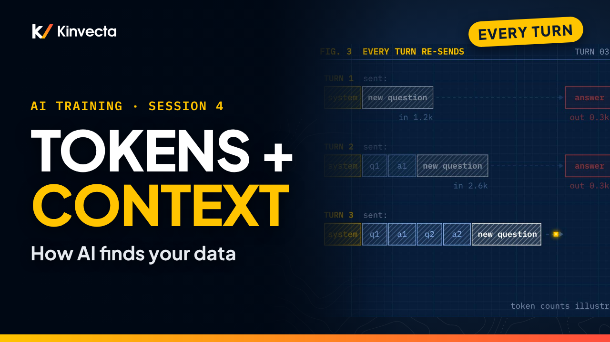

# Session 4 · Tokens, context and how AI finds your data

  

**Length:** 7:00 · **For:** Everyone · **Classroom version:** 90 minutes

Why did the AI bill surprise you? Why did it forget what you said? Why couldn't it find the table? All three come down to what the model can see. Session 4 of the Kinvecta AI training series explains tokens, the context window, and the different ways AI tools fetch your data.

## What you'll learn

- What a token is, and why codes and numbers cost more
- The types of tokens (input, output, thinking, cached, image, tool, embedding) and what each costs
- What fills the context window, and why caching makes stable instructions cheap
- Why long chats get more expensive every turn
- How AI finds your data: semantic search, keyword search, agentic search, structured queries and multimodal retrieval
- How to match the right finder to your data, and why a search index is a security question

## Rule of thumb

> **Send less. Cache what's stable. Fetch with the finder that fits.**

## Chapters

- 0:00 Welcome: what can the model see?
- 0:30 What you'll be able to do
- 0:49 Three complaints, one root cause
- 1:16 What a token is
- 1:48 Types of tokens
- 2:19 The context window budget
- 2:52 Why long chats cost more
- 3:19 Six reasons tokens matter
- 3:46 How AI finds your data
- 4:23 Six ways AI fetches data
- 4:58 Match the finder to the data
- 5:25 The rule of thumb
- 5:37 Exercise: count it, then find it
- 6:14 Check your understanding
- 6:37 Next: APIs, endpoints and containers (Session 5)

## In this folder

| File | What it is |
|---|---|
| [`slides.pdf`](slides.pdf) | The slides from the video, one page per slide |
| [`transcript/Session 4 - Tokens, Context and How AI Finds Your Data - transcript.txt`](transcript/Session%204%20-%20Tokens%2C%20Context%20and%20How%20AI%20Finds%20Your%20Data%20-%20transcript.txt) | The narration as text, with chapter times |

Watch the whole series in order in the [YouTube playlist](https://www.youtube.com/playlist?list=PLQqgikRVyDAM). [Back to the course](../README.md#course) · [Versión en español](../es/Sesi%C3%B3n%204%20-%20Tokens%2C%20contexto%20y%20c%C3%B3mo%20encuentra%20la%20IA%20tus%20datos/)
