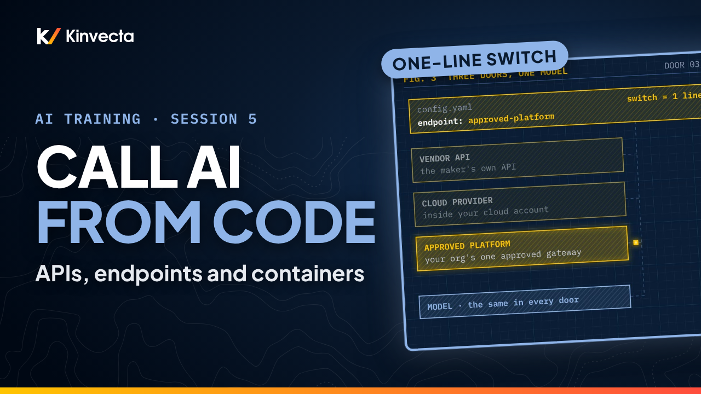

# Session 5 · APIs, endpoints and containers

[](https://youtu.be/LbK3n2ddfek) [](slides.pdf) [](transcript/Session%205%20-%20APIs%2C%20Endpoints%20and%20Containers%20-%20transcript.txt)

<a href="https://youtu.be/LbK3n2ddfek"></a>

**Length:** 6:07 · **For:** Automators · **Classroom version:** 90 minutes

When your own software calls an AI model, there's no chat app in between, so your team owns the controls. Session 5 of the Kinvecta AI training series explains what changes when code calls the model, where the API comes from, and how containers keep it safe. No coding needed.

## What you'll learn

- What changes when your code calls the model: the six jobs the chat app used to do for you
- The three front doors to the same model (vendor API, cloud provider, approved platform), and why you authorize first
- Four habits that make switching vendors a one-line change: endpoint in config, pinned model version, one request shape, allow-list
- How a container seals your code in, with one way out
- The four run controls: secrets at run time, a pinned model, logging, and rate and cost limits
- Why chat plus an API already gets most teams to Stage 3

## Rule of thumb

> **Call it from code. Keep the endpoint in config. Seal it in a container.**

## Key ideas

- When your code calls the model through the API, your software becomes the harness. The six jobs the chat app did now belong to your team: instructions, data handling, logging, keys and network, review, and cost limits.
- The API is not the chat app. The terms, data retention and authorization are different, so check them before you build.
- There are three front doors to the same model: the vendor's own API, a cloud provider's hosted version, and your organization's approved platform. The model behind every door is the same; the contract changes. Choose the door by its terms and approvals first, then the model.
- Four habits make a switch a one-line change: endpoint in config, pinned model version (never "latest"), one request shape, and an allow-list for that one endpoint.
- Every harness runs sealed in a container with one way out. A call to the approved endpoint goes through; a request to any other website, or a reach for the host's own files, is blocked at the wall, so an injected instruction has nowhere to send your data.
- Every run leaves a record: secrets injected at run time, a pinned model, an audit log, and rate and cost limits. Chat plus an API already gets a team to Stage 3.

## Key terms

| Term | Plain-language meaning |
|---|---|
| API | The way one piece of software talks to another. Your code sends a request to the model and gets an answer back, with no chat app in between. |
| Endpoint | The address your code sends the request to. The same model can sit behind a vendor endpoint, a cloud provider endpoint or your organization's approved platform. |
| Harness | Everything around the model that decides what it gets and what it may do. When you call the API, your own software is the harness. |
| Config | Settings kept outside the code, such as the endpoint and the model version, so a change is one line, not a rewrite. |
| Pinned model version | Naming one exact model version instead of "latest", so the model only changes when you decide, after tests pass. |
| Allow-list | The short list of addresses the container is permitted to reach. Everything else is blocked. |
| Container | A sealed box that holds the reviewed libraries, your code and the saved prompt, with one way out to the approved endpoint. |
| Secrets store | Where keys live. The key is injected at run time, never written into code, prompts or logs. |
| Audit log | The record of each run: who ran it, which prompt, which model, how many tokens, and who reviewed it. |
| Rate and cost limits | Caps on how often the workflow may call the model and how much it may spend, so a loop can't run up the bill. |

## Try it

About 15 minutes. Paper or a text file is enough; you don't need to run anything.

**Part A: read it (5 minutes).** Here is the pseudocode from the exercise slide, where `doc` is the file being summarized. Find five problems. Hints: key, endpoint, model, prompt, reply.

```
1  API_KEY = "sk-4f9a..."
2  url = "https://api.vendor.example/v1"
3  model = "latest"
4  prompt = "Summarize this: " + doc
5  reply = send(url, API_KEY, model, prompt)
6  print(reply)
```

<details><summary>Check your answers</summary>

1. The key is pasted into the code (line 1). It belongs in a secrets store and should be injected at run time.
2. The endpoint is hard-coded (line 2). It belongs in config, so switching doors is a one-line change and the allow-list can match it.
3. The model is "latest" (line 3). Pin an exact version, and switch on purpose after tests pass.
4. The prompt is typed inline (line 4). Load a saved, versioned prompt from the library instead.
5. The reply is printed and that's the end (line 6). Nothing is logged, no one reviews it, and there is no rate or cost limit.

If you found the key first, you're not alone.

</details>

**Part B: box it (10 minutes).** Imagine a weekly contract-summary workflow that runs on made-up sample documents (no real contracts needed). Fill in the blank container:

| | Your answer |
|---|---|
| Inside the container | |
| The one endpoint it can reach | |
| Where the key comes from | |
| What each run logs | |
| Its rate and cost limit | |

<details><summary>One good answer</summary>

Inside: the reviewed libraries, your code and the saved summary prompt. One endpoint: the approved model endpoint named in config, and nothing else. Key: injected at run time from the secrets store. Each run logs: who ran it, which prompt version, which model version, how many tokens, and who reviewed the output. Limit: a cap on calls per hour and a spend limit per week that stops the run when it's reached.

</details>

## Check your understanding

1. When your code calls the model instead of the chat app, what does your team now have to handle?

   <details><summary>Answer</summary>The six jobs the chat app did: instructions (saved prompts), data handling, logging, keys and network, human review, and cost limits.</details>

2. Name the three kinds of endpoint.

   <details><summary>Answer</summary>The vendor's own API, a cloud provider's hosted version, and an approved platform or gateway.</details>

3. Which do you choose first, the door or the model, and why?

   <details><summary>Answer</summary>The door. The model behind every door is the same; what changes is the contract: terms, data retention and approval.</details>

4. Why keep the endpoint in config?

   <details><summary>Answer</summary>So switching is a one-line change, and the network allow-list can match it.</details>

5. What can a container reach?

   <details><summary>Answer</summary>Only the approved model endpoint and any approved tool servers. Everything else, including the host's own files, is blocked.</details>

6. Name the four run controls.

   <details><summary>Answer</summary>Secrets injected at run time from a secrets store, a pinned model version, an audit log of every run, and rate and cost limits.</details>

## Further reading

- [The Twelve-Factor App: Config](https://12factor.net/config). The classic case for keeping settings such as endpoints out of the code.
- [OWASP Secrets Management Cheat Sheet](https://cheatsheetseries.owasp.org/cheatsheets/Secrets_Management_Cheat_Sheet.html). How to keep keys out of code, repositories and logs.
- [NIST SP 800-190: Application Container Security Guide](https://csrc.nist.gov/pubs/sp/800/190/final). The reference guide to container risks and countermeasures.
- [What is a container?](https://docs.docker.com/get-started/docker-concepts/the-basics/what-is-a-container/) (Docker docs). A short, plain introduction to what a container is and isn't.
- [OWASP API Security Top 10](https://api-security.owasp.org/). The most common ways APIs go wrong, and what to ask for.

## Chapters

- 0:00 Welcome: who owns the controls?
- 0:27 What you'll be able to do
- 0:46 Three problems that start when code calls the model
- 1:14 Through the API, your code becomes the harness
- 1:43 Six jobs your code now owns
- 2:10 Three front doors to the same model
- 2:40 Four habits: keep the endpoint in config
- 2:57 Sealed in a container, one way out
- 3:30 The four run controls
- 3:56 What you can do today
- 4:16 The rule of thumb
- 4:30 Exercise: read it, then box it
- 5:02 Check your understanding
- 5:29 Next: building workflows (Session 6)
- 5:46 For facilitators: the Stage 2 sandbox

## In this folder

| File | What it is |
|---|---|
| [`slides.pdf`](slides.pdf) | The slides from the video, one page per slide |
| [`transcript/Session 5 - APIs, Endpoints and Containers - transcript.txt`](transcript/Session%205%20-%20APIs%2C%20Endpoints%20and%20Containers%20-%20transcript.txt) | The narration as text, with chapter times |

Watch the whole series in order in the [YouTube playlist](https://www.youtube.com/playlist?list=PLQqgikRVyDAM). [Back to the course](../README.md#course) · [Versión en español](../es/Sesi%C3%B3n%205%20-%20APIs%2C%20endpoints%20y%20contenedores/)
