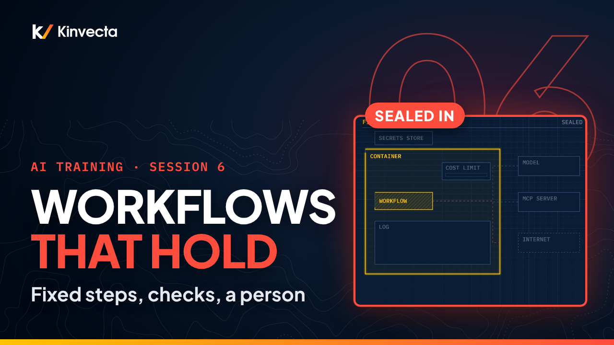

# Session 6 · Building workflows that don't break

  

**Length:** 7:04 · **For:** Automators · **Classroom version:** 90 minutes

Pasting the same prompt every Monday? Session 6 of the Kinvecta AI training series shows how to turn a repeat task into a safe, fixed AI workflow: the same steps every run, a check on every output, and a person who approves before anything ships. No agents required.

## What you'll learn

- The difference between a chatbot, a workflow and an agent: who picks each step
- How far you can go with just chat plus an API (Stage 3: working automation)
- How to score a task to find a good first workflow
- The anatomy of a workflow: trigger, inputs, saved prompt, validation, review, delivery
- How validation catches bad output before it moves on
- How to run it safely: container, secrets, logs and cost limits
- Why a new prompt version is a new release, tested before it goes live
- Four numbers that prove a workflow is working

## Rule of thumb

> **Fix the path. Check every output. A person approves before it ships.**

## Chapters

- 0:00 Welcome: three Mondays, one fixed path
- 0:34 What you'll be able to do
- 0:56 Why repeat work needs a fixed path
- 1:23 Chatbot, workflow or agent: who picks each step?
- 2:01 What you can build today
- 2:32 Score your first workflow
- 2:56 Anatomy of a workflow
- 3:36 Check every output
- 4:06 Run it safely: sealed in, logged, capped
- 4:32 Test it, then version it
- 5:01 Four numbers that prove it's working
- 5:16 The rule of thumb
- 5:31 Exercise: design it, then break it
- 6:12 Check your understanding
- 6:42 Next: tools, MCP and prompt injection (Session 7)

## In this folder

| File | What it is |
|---|---|
| [`slides.pdf`](slides.pdf) | The slides from the video, one page per slide |
| [`transcript/Session 6 - Building Workflows - transcript.txt`](transcript/Session%206%20-%20Building%20Workflows%20-%20transcript.txt) | The narration as text, with chapter times |

Watch the whole series in order in the [YouTube playlist](https://www.youtube.com/playlist?list=PLQqgikRVyDAM). [Back to the course](../README.md#course) · [Versión en español](../es/Sesi%C3%B3n%206%20-%20C%C3%B3mo%20construir%20flujos%20de%20trabajo/)
