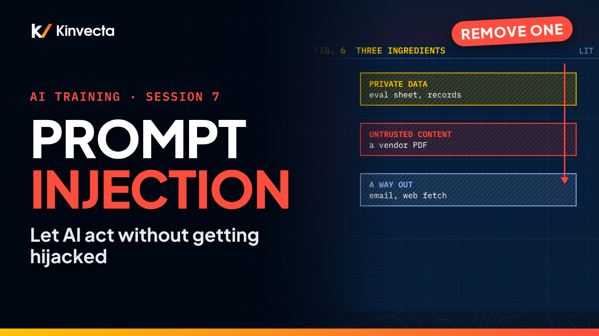

# Session 7 · Tools, MCP and prompt injection

  

**Length:** 7:35 · **For:** Automators · **Classroom version:** 90 minutes

Tools make AI useful: it can look things up and take actions. They also make mistakes real. Session 7 of the Kinvecta AI training series explains how tool calling works, how MCP (the Model Context Protocol) plugs tools into any AI harness, and how to stop prompt injection, the number-one risk for AI applications.

## What you'll learn

- How tool calling works: the model asks, the harness decides
- The parts of an AI system: model, skills, tools and the harness around them
- What an MCP server is, and how one server serves a chat app, a workflow and an agent
- How an MCP call works, step by step
- Three rules for building a tool your team can trust
- How prompt injection works, the three ingredients of an attack, and the layered defenses that stop it
- Why tools are software: one review-and-release pipeline for all of them

## Rule of thumb

> **Read tools run freely, from approved sources. Action tools wait for a person. Everything returned is data.**

## Chapters

- 0:00 Welcome: the model asks, the harness decides
- 0:26 What you'll be able to do
- 0:47 Why tools raise the stakes
- 1:11 Tool calling
- 1:44 The parts of an AI system
- 2:07 MCP: one tool server, many harnesses
- 2:38 How an MCP call works
- 3:10 Three rules for building a tool
- 3:28 Prompt injection
- 4:16 The three ingredients of an attack
- 4:41 Layered defenses
- 5:24 Tools are software
- 5:47 The rule of thumb
- 6:02 Exercise: trace it, then gate it
- 6:47 Check your understanding
- 7:13 Next: agents, skills and running the program (Session 8)

## In this folder

| File | What it is |
|---|---|
| [`slides.pdf`](slides.pdf) | The slides from the video, one page per slide |
| [`transcript/Session 7 - Tools, MCP and Prompt Injection - transcript.txt`](transcript/Session%207%20-%20Tools%2C%20MCP%20and%20Prompt%20Injection%20-%20transcript.txt) | The narration as text, with chapter times |

Watch the whole series in order in the [YouTube playlist](https://www.youtube.com/playlist?list=PLQqgikRVyDAM). [Back to the course](../README.md#course) · [Versión en español](../es/Sesi%C3%B3n%207%20-%20Herramientas%2C%20MCP%20e%20inyecci%C3%B3n%20de%20prompts/)
