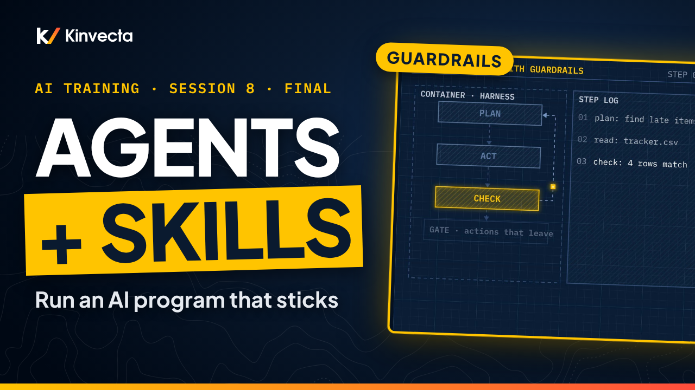

# Session 8 · Agents, skills and running the program

  

**Length:** 7:14 · **For:** Automators and leaders · **Classroom version:** 90 minutes

Training only works when the work changes. In the final session of the Kinvecta AI training series, we put the pieces together: skills, tools and a model working as one repeatable job, agents with guardrails, a shared prompt and skill library, and how to roll the program out and prove it worked.

## What you'll learn

- What an AI skill is, how it loads in layers, and why it stays cheap
- Why every skill should be treated like code (read, scan, pin, internal registry)
- How a skill, tools and a model combine into one repeatable job
- How to put guardrails on an agent: a container, a step log, and a person who approves what leaves
- How a saved prompt becomes a reviewed, versioned skill in one shared library
- The five stages of an AI program, the new risk at each stage, and where each role stops
- How to measure whether training worked: baselines first, then count work, not courses

## Rule of thumb

> **Write it once, as a skill. Gate what leaves. Measure what changes.**

## Chapters

- 0:00 Welcome: putting the pieces together
- 0:26 What you'll be able to do
- 0:47 Three ways AI programs stall
- 1:16 How a skill loads in layers
- 1:45 Treat every skill like code
- 2:11 Skill + tools + model: one repeatable job
- 2:51 Agents with guardrails
- 3:25 One shared prompt and skill library
- 3:50 Five stages, one new risk each
- 4:32 Measuring what changed
- 5:08 The rule of thumb
- 5:21 Exercise: package it, then plan it
- 6:04 Check your understanding
- 6:31 Series complete: your next step

## In this folder

| File | What it is |
|---|---|
| [`slides.pdf`](slides.pdf) | The slides from the video, one page per slide |
| [`transcript/Session 8 - Agents, Skills and Running the Program - transcript.txt`](transcript/Session%208%20-%20Agents%2C%20Skills%20and%20Running%20the%20Program%20-%20transcript.txt) | The narration as text, with chapter times |

Watch the whole series in order in the [YouTube playlist](https://www.youtube.com/playlist?list=PLQqgikRVyDAM). [Back to the course](../README.md#course) · [Versión en español](../es/Sesi%C3%B3n%208%20-%20Agentes%2C%20skills%20y%20c%C3%B3mo%20dirigir%20el%20programa/)
