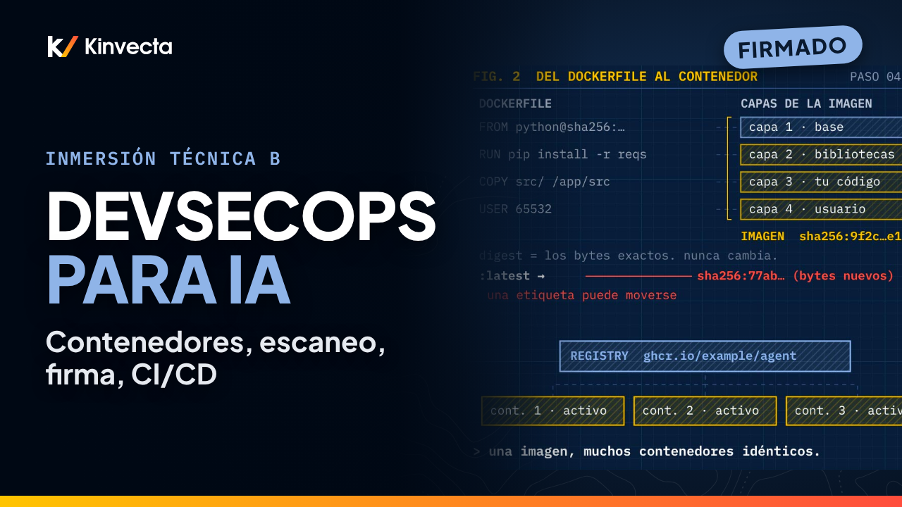

# Inmersión técnica B · DevSecOps, contenedores, escaneo y el pipeline de CI/CD

   

**Duración:** 23:39 · **Para:** Quienes desarrollan y revisan · **Versión en aula:** 120 minutos

¿Cómo liberas software en el que de verdad puedes confiar, y sigues confiando en él? Esta inmersión técnica de la Capacitación en IA de Kinvecta recorre DevSecOps para cargas de trabajo de IA de principio a fin: qué es realmente un contenedor, dónde corren los contenedores, cómo endurecer una imagen, dónde viven los secretos, cómo funcionan el escaneo y el triaje, cómo la firma demuestra que publicaste la misma caja que escaneaste, cómo el pipeline de CI/CD lo hace cumplir todo y cómo los firewalls lo cercan, en ambas direcciones.

## Vas a aprender

- DevSecOps: seguridad en cada etapa, no un solo punto de control al final (shift left, y sigue vigilando a la derecha)
- Imágenes, contenedores y registries, y por qué el digest, no la etiqueta, es la identidad real
- Dónde corren los contenedores: laptop, un solo servidor, contenedores serverless, Kubernetes, el borde y redes aisladas, y quién parcha qué
- Cómo endurecer un Dockerfile: base mínima fijada, build multietapa, sin secretos y sin root
- Dónde viven los secretos: nunca en la imagen ni en el repo; gestores de secretos, identidad de carga de trabajo con OIDC e inyección en tiempo de ejecución
- Los tipos de escaneo (secretos, SAST, SCA, IaC, imagen, SBOM, DAST) y las herramientas de código abierto y comerciales para cada uno
- Un triaje que funciona: primero KEV, luego EPSS, luego los críticos con corrección, y VEX para lo que no aplica
- Firma, atestaciones y control de admisión (Cosign, SBOM, procedencia, Kyverno)
- Un pipeline real de GitHub Actions, anotado, y por qué se fijan las actions por SHA de commit completo
- Firewalls y controles de red: WAF, firewalls de nube y de host, la trampa de Docker y ufw, NetworkPolicy y listas de permitidos de salida
- Puntos de control específicos de IA: modelos y prompts fijados, evals, escaneo de MCP y skills, y control de salida

## La regla de oro

> **Fija todas las versiones. Escanea antes de publicar. Firma y publica el mismo digest.**

## Capítulos

- 0:00 Bienvenida: una caja, confiable en todos lados
- 0:37 Lo que vas a poder hacer
- 1:05 Tres problemas que resuelve un buen pipeline
- 1:47 DevSecOps: seguridad en cada etapa
- 2:42 Imagen, contenedor, registry y digest
- 3:34 Dónde corren los contenedores
- 4:50 Endurecer la imagen
- 5:50 Lee un Dockerfile endurecido
- 7:08 Dónde viven los secretos
- 8:18 Un escáner en cada estación
- 9:20 Herramientas de escaneo por categoría
- 10:45 Triaje: corrige primero lo que ya se explota
- 11:59 Firmar, atestar y verificar
- 12:59 Herramientas de firma, registry, admisión y runtime
- 14:12 La línea de CI/CD y sus puntos de control
- 15:15 Un pipeline de GitHub Actions, anotado
- 16:24 Cuando el escáner es el ataque
- 17:20 Firewalls: denegar por defecto, en ambas direcciones
- 18:34 Capas de red y sus herramientas
- 20:04 Puntos de control específicos de IA
- 20:56 La regla de oro
- 21:13 Ejercicio: encuentra los problemas y haz el triaje
- 22:19 Pon a prueba lo aprendido
- 23:18 Cierre: constrúyelo, empácalo, publícalo

## En esta carpeta

| Archivo | Qué es |
|---|---|
| [`slides.pdf`](slides.pdf) | Las diapositivas del video, una página por diapositiva |
| [`transcripción/Inmersión técnica B - DevSecOps, contenedores, escaneo y el pipeline de CI-CD - transcripción.txt`](transcripci%C3%B3n/Inmersi%C3%B3n%20t%C3%A9cnica%20B%20-%20DevSecOps%2C%20contenedores%2C%20escaneo%20y%20el%20pipeline%20de%20CI-CD%20-%20transcripci%C3%B3n.txt) | La narración en texto, con los tiempos de cada capítulo |
| [Investigación](../../Deep%20Dive%20B%20-%20DevSecOps%20Containers%2C%20Scanning%20and%20CI-CD/research-brief.md) | La investigación detrás de la sesión, con fuentes (en inglés) |

Ve la serie completa en orden en la [lista de YouTube](https://www.youtube.com/playlist?list=PLPYZqM8a_06M). [Volver al curso](../README.md) · [English version](../../Deep%20Dive%20B%20-%20DevSecOps%20Containers%2C%20Scanning%20and%20CI-CD/)
