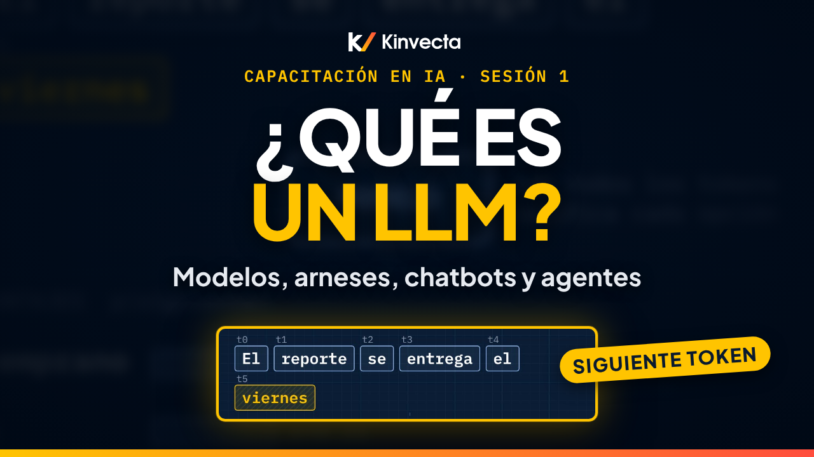

# Sesión 1 · ¿Qué es un LLM? Modelos, arneses, chatbots, flujos de trabajo y agentes

  

**Duración:** 12:37 · **Para:** Todos · **Versión en aula:** 90 minutos

¿Qué es realmente un LLM (modelo de lenguaje grande)? ¿Y qué es el arnés (en inglés, harness), la app o plataforma que lo rodea y decide qué puede ver y hacer? La Sesión 1 de la Capacitación en IA de Kinvecta explica el vocabulario base para usar bien y con seguridad la IA generativa en el trabajo.

## Vas a aprender

- Qué es un LLM y qué no es: predice el siguiente token, sus pesos están congelados y no aprende de tus chats
- Cómo se hace un modelo: preentrenamiento, posentrenamiento y despliegue
- Por qué una sola solicitud pasa por varios modelos
- La regla de oro: el modelo piensa, las skills le enseñan cómo, las herramientas le permiten actuar y el arnés decide cuáles le da
- Los seis tipos de arnés y cómo compararlos por alcance y autonomía
- Las tres puertas de entrada a la API: proveedor, nube y plataforma aprobada
- La diferencia entre un chatbot, un flujo de trabajo y un agente: ¿quién elige cada paso?

## La regla de oro

> **El modelo piensa. Las skills le enseñan cómo. Las herramientas le permiten actuar. Y el arnés decide cuáles le da.**

Cuando tu propio software llama al modelo por la API, tu software se vuelve el arnés.

## Ideas clave

- Un LLM es un motor entrenado que predice y escribe texto, un token (un pedazo de texto) a la vez. Por eso suena tan fluido, y por eso también puede equivocarse con mucha fluidez.
- Sus pesos se congelan después del entrenamiento. No aprende de tus chats: lo que las apps llaman "memoria" es el arnés guardando notas y volviéndolas a meter.
- El arnés decide qué puede ver y hacer el modelo. El mismo modelo puede ser seguro en una app y riesgoso en otra, así que seguridad aprueba el arnés, no solo el modelo.
- Hay seis tipos de arnés: asistentes de chat, IA integrada en herramientas, plataformas de la organización, herramientas de código y de agentes, agentes de código abierto y tu propio software por la API. Aprende las categorías, no las marcas.
- Para evaluar un arnés, haz dos preguntas: ¿a qué puede llegar? y ¿cuánto actúa por su cuenta? Entre más arriba y a la derecha, más controles necesita.
- Chatbot, flujo de trabajo y agente se distinguen por quién elige cada paso: la persona, quien lo diseña por adelantado o la IA en tiempo de ejecución. Elige un flujo de trabajo cuando los pasos se conocen.

## Términos clave

| Término | Qué significa |
|---|---|
| LLM (modelo de lenguaje grande) | Un motor entrenado que predice y produce texto, un token a la vez |
| Token | Un pedazo de texto que el modelo lee y escribe; más o menos tres cuartas partes de una palabra en inglés |
| Pesos | Los valores que el modelo aprendió en su entrenamiento; se congelan antes del despliegue |
| Arnés (harness) | El software que rodea al modelo y decide qué puede ver y hacer |
| Skill | Un paquete de instrucciones, plantillas y archivos que el modelo carga solo cuando lo necesita |
| Herramienta | Lo que le permite al modelo consultar datos o tomar acciones; el arnés decide cuáles le da |
| API | La puerta por la que tu software llama al modelo |
| Chatbot | La persona elige cada paso de la conversación |
| Flujo de trabajo | Quien lo diseña fija los pasos por adelantado; el script sigue la misma ruta cada vez |
| Agente | La IA elige los pasos en tiempo de ejecución, dentro de los límites que le pone el arnés |

## Pruébalo

Un ejercicio de autoestudio de 15 minutos, basado en el ejercicio del video (capítulo 10:17).

1. **Clasifica tareas (5 minutos).** Escribe diez tareas con IA que veas en tu trabajo (por ejemplo, "resumir una minuta", "mandar el reporte semanal cada lunes", "investigar un proveedor y redactar la comparación"). Clasifica cada una como chatbot, flujo de trabajo o agente. La prueba es siempre la misma: ¿quién elige cada paso?
2. **Inventaría un arnés (8 minutos).** Elige una herramienta de IA que use tu equipo hoy y responde cinco preguntas: ¿cuál de los seis tipos es? ¿Qué modelos tiene detrás? ¿A qué puede llegar? ¿Cuánto actúa por su cuenta? ¿Quién la aprobó, y para qué datos?
3. **Cierra (2 minutos).** Si no pudiste responder la última pregunta, anótalo: ese es tu primer hallazgo y vale la pena darle seguimiento.

## Pon a prueba lo aprendido

Las seis preguntas de repaso de la guía maestra. Intenta responder antes de abrir cada respuesta.

1. En una oración, ¿qué es un modelo de lenguaje grande?
   

Respuesta
Un motor entrenado que predice y produce texto, un token a la vez.

2. ¿Por qué el mismo modelo puede ser seguro en una app y riesgoso en otra?
   

Respuesta
El arnés decide qué puede ver y hacer. Seguridad aprueba el arnés, no solo el modelo.

3. ¿El modelo aprende de tus chats? Entonces, ¿qué es la "memoria"?
   

Respuesta
No. Los pesos están congelados después del entrenamiento. La memoria es el arnés guardando notas y volviéndolas a meter.

4. Nombra tres tipos de arnés y un ejemplo de cada uno.
   

Respuesta
Tres de los seis: asistentes de chat, IA integrada en herramientas, plataformas o gateways de la organización, herramientas de código y de agentes, agentes de código abierto, tu propio software por la API.

5. ¿Quién elige cada paso en un chatbot, un flujo de trabajo y un agente?
   

Respuesta
La persona; quien lo diseña, por adelantado; la IA, en tiempo de ejecución.

6. ¿Cuándo elegirías un flujo de trabajo en vez de un agente?
   

Respuesta
Cuando los pasos se conocen de antemano. Es más predecible y más fácil de autorizar y probar.

## Para leer más

- [Introducción a los modelos de lenguaje grandes](https://developers.google.com/machine-learning/crash-course/llm?hl=es-419), módulo del curso intensivo de aprendizaje automático de Google, en español: tokens, contexto y cómo predice un modelo de lenguaje
- [Top 10 2025 de riesgos y mitigaciones para LLMs y aplicaciones de IA generativa](https://genai.owasp.org/resource/top-10-2025-de-riesgos-y-mitigaciones-para-llms-y-aplicaciones-de-ia-generativa/), la traducción oficial de OWASP al español
- [¿Qué es el Model Context Protocol (MCP)?](https://modelcontextprotocol.io/docs/getting-started/intro) (en inglés), el estándar abierto con el que el arnés conecta herramientas al modelo
- [Building effective agents](https://www.anthropic.com/research/building-effective-agents) (en inglés), la distinción entre flujos de trabajo con rutas fijas y agentes que eligen sus pasos
- [Agent Skills](https://agentskills.io/) (en inglés), el formato abierto de skills: una carpeta con un archivo `SKILL.md` que el agente carga solo cuando lo necesita

## Capítulos

- 0:00 Bienvenida: el modelo y el arnés
- 0:27 Lo que vas a poder hacer
- 0:54 Por qué empezar por el vocabulario
- 1:31 Qué es un LLM: predecir el siguiente token
- 2:26 Cómo se hace un modelo
- 3:03 Seis creencias que hay que corregir
- 3:49 Una solicitud pasa por varios modelos
- 4:30 La regla de oro
- 4:48 Las partes de un sistema de IA
- 5:39 El mismo modelo en tres arneses
- 6:24 Los seis tipos de arnés
- 7:18 Cómo comparar arneses: alcance y autonomía
- 7:54 Tres puertas de entrada a la API
- 8:38 Chatbot, flujo de trabajo y agente
- 9:35 Hasta dónde puedes llegar
- 10:17 Ejercicio: clasifica tareas e inventaría un arnés
- 11:10 Pon a prueba lo aprendido
- 11:50 Lo que sigue: Resiliencia en IA (Sesión 2)

## En esta carpeta

| Archivo | Qué es |
|---|---|
| [`slides.pdf`](slides.pdf) | Las diapositivas del video, una página por diapositiva |
| [`transcripción/Sesión 1 - Qué es un LLM - transcripción.txt`](transcripci%C3%B3n/Sesi%C3%B3n%201%20-%20Qu%C3%A9%20es%20un%20LLM%20-%20transcripci%C3%B3n.txt) | La narración en texto, con los tiempos de cada capítulo |

Ve la serie completa en orden en la [lista de YouTube](https://www.youtube.com/playlist?list=PLPYZqM8a_06M). [Volver al curso](../README.md) · [English version](../../Session%201%20-%20What%20an%20LLM%20Is/)
