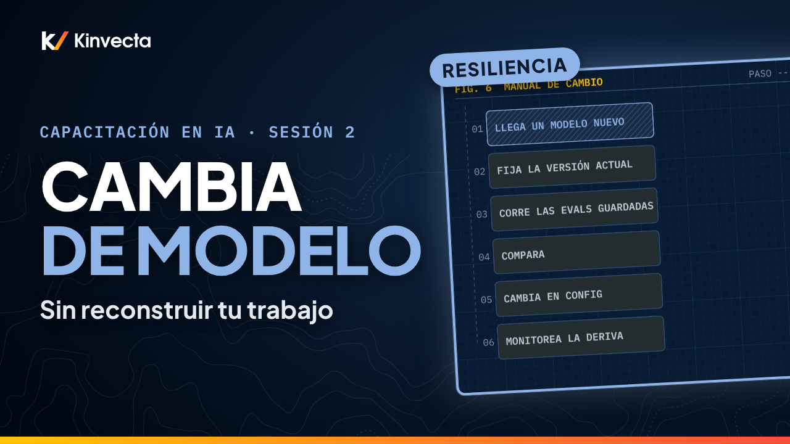

# Sesión 2 · Resiliencia en IA: cambia de modelo o de proveedor sin reconstruir

  

**Duración:** 9:48 · **Para:** Todos · **Versión en aula:** 90 minutos

Los modelos se retiran, los términos cambian y lo que seguridad aprueba hoy puede cambiar mañana. ¿Qué es tuyo y sobrevive a un cambio? La Sesión 2 de la Capacitación en IA de Kinvecta explica cómo volver agnóstica a tu organización: poder cambiar el modelo, o todo el proveedor, sin reconstruir tu trabajo.

## Vas a aprender

- Qué rentas (modelos, apps y arneses) y qué es tuyo
- Los cuatro niveles de cambio: versión del modelo, proveedor, endpoint y arnés
- Los siete fundamentos que le pertenecen a tu organización, de las herramientas MCP a las evals guardadas
- Cómo cambiar de modelo se vuelve un cambio de una línea en la configuración
- Cómo escribir una skill una vez y probarla en cada arnés
- Cómo las evals detectan la deriva del modelo y la deriva del caso de uso
- La regla de oro: renta el modelo; quédate con las conexiones, el know-how y las pruebas

## La regla de oro

> **Renta el modelo. Quédate con las conexiones. Quédate con el know-how. Y quédate con las pruebas.**

## Capítulos

- 0:00 Bienvenida: ¿qué es tuyo y sobrevive a un cambio?
- 0:30 Lo que vas a poder hacer
- 0:56 Por qué importa la resiliencia
- 1:25 Rentar o ser dueño
- 2:04 Cuatro niveles de cambio
- 2:44 Cuatro creencias que hay que corregir
- 3:21 Siete fundamentos, un ciclo
- 4:16 Las siete cosas que son tuyas
- 5:02 Cambia de modelo en una sola línea
- 5:44 Una skill, escrita una vez, en cada arnés
- 6:21 Las evals te dicen si un cambio funcionó
- 7:01 La regla de oro
- 7:20 Manual de cambio: prueba antes de cambiar
- 7:54 Ejercicio: auditoría de dependencia
- 8:34 Pon a prueba lo aprendido
- 9:13 Lo que sigue: Prompts seguros y verificación (Sesión 3)

## En esta carpeta

| Archivo | Qué es |
|---|---|
| [`slides.pdf`](slides.pdf) | Las diapositivas del video, una página por diapositiva |
| [`transcripción/Sesión 2 - Resiliencia en IA - transcripción.txt`](transcripci%C3%B3n/Sesi%C3%B3n%202%20-%20Resiliencia%20en%20IA%20-%20transcripci%C3%B3n.txt) | La narración en texto, con los tiempos de cada capítulo |

Ve la serie completa en orden en la [lista de YouTube](https://www.youtube.com/playlist?list=PLPYZqM8a_06M). [Volver al curso](../README.md) · [English version](../../Session%202%20-%20AI%20Resilience/)
