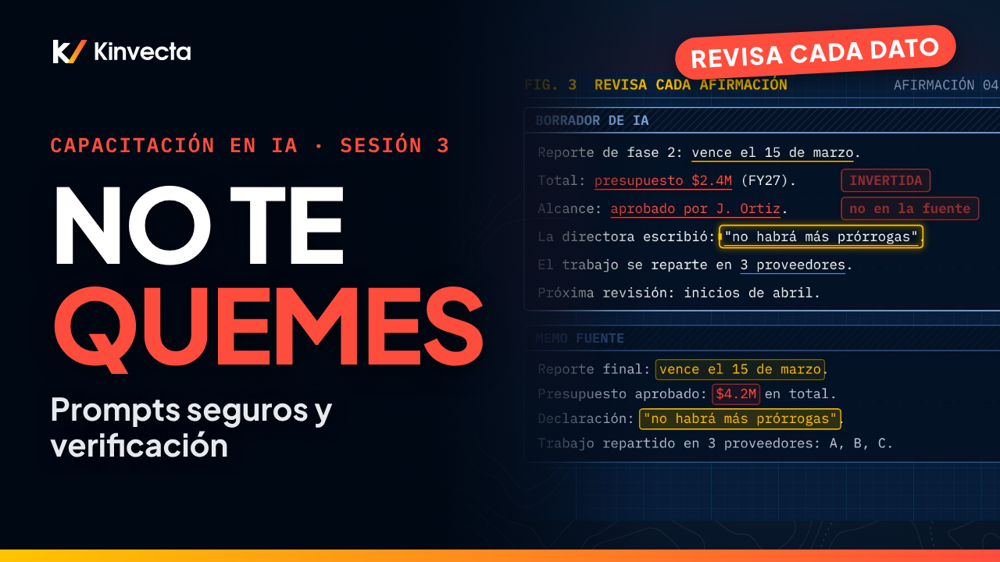

# Sesión 3 · Prompts seguros y verificación

  

**Duración:** 7:52 · **Para:** Todos · **Versión en aula:** 90 minutos

Que suene bien no significa que sea correcto. Casi todos los problemas con IA en el trabajo nacen de un hábito, no de la tecnología. La Sesión 3 de la Capacitación en IA de Kinvecta enseña los hábitos diarios que mantienen tu uso de la IA seguro y útil: qué datos van a qué herramienta, cómo darle contexto como a un colega y cómo revisar cada afirmación antes de usar un borrador.

## Vas a aprender

- La regla clave: los datos solo van a una herramienta aprobada para su nivel de sensibilidad
- Qué hacer en los primeros minutos si pegaste algo que no debías
- Por qué la IA redacta y una persona firma: responsabilidad, registros y uso responsable
- Cómo escribir un prompt con contexto: rol, tarea, público, formato y la fuente pegada
- Cómo verificar un borrador afirmación por afirmación, y cómo se ve una alucinación
- Una lista de verificación de seis puntos antes de usar cualquier borrador
- Cómo convertir un prompt que funciona en una instrucción guardada, revisada y probada

## La regla de oro

> **Herramienta aprobada para cada dato. Dale contexto como a un colega. Revisa cada afirmación. Y una persona firma.**

## Capítulos

- 0:00 Bienvenida: hábitos para usar la IA con seguridad
- 0:29 Lo que vas a poder hacer
- 0:50 Por qué importa: hábitos, no tecnología
- 1:23 La regla clave: herramienta aprobada para cada dato
- 2:02 Niveles de datos y herramientas
- 2:33 Si pegaste algo que no debías
- 2:59 La IA redacta, una persona firma
- 3:30 Prompts con contexto, como para un colega
- 4:16 Verificación: revisa cada afirmación
- 4:55 Lista de verificación de seis puntos
- 5:19 Guarda lo que funciona
- 5:58 La regla de oro
- 6:17 Ejercicio: dale contexto, revísalo, guárdalo
- 6:52 Pon a prueba lo aprendido
- 7:29 Lo que sigue: Tokens, contexto y cómo encuentra la IA tus datos (Sesión 4)

## En esta carpeta

| Archivo | Qué es |
|---|---|
| [`slides.pdf`](slides.pdf) | Las diapositivas del video, una página por diapositiva |
| [`transcripción/Sesión 3 - Prompts seguros y verificación - transcripción.txt`](transcripci%C3%B3n/Sesi%C3%B3n%203%20-%20Prompts%20seguros%20y%20verificaci%C3%B3n%20-%20transcripci%C3%B3n.txt) | La narración en texto, con los tiempos de cada capítulo |

Ve la serie completa en orden en la [lista de YouTube](https://www.youtube.com/playlist?list=PLPYZqM8a_06M). [Volver al curso](../README.md) · [English version](../../Session%203%20-%20Safe%20Prompting%20and%20Verification/)
