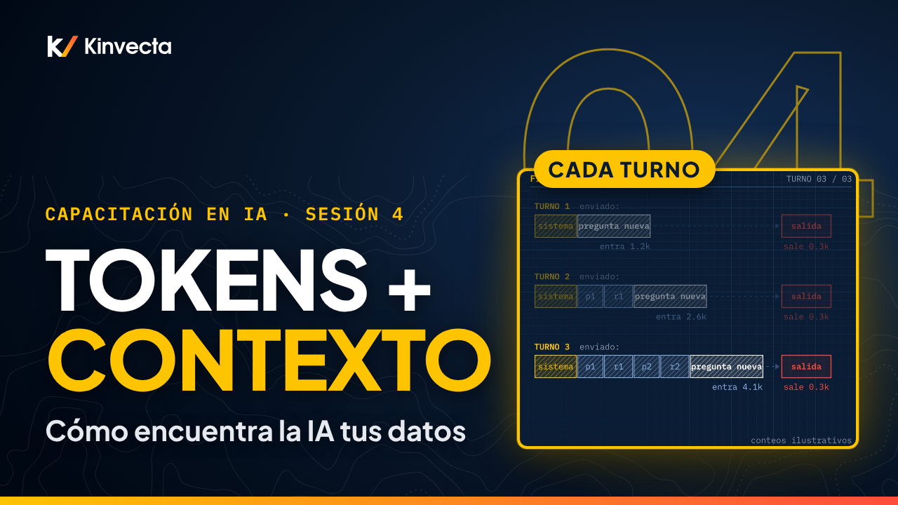

# Sesión 4 · Tokens, contexto y cómo encuentra la IA tus datos

  

**Duración:** 8:17 · **Para:** Todos · **Versión en aula:** 90 minutos

¿Por qué te sorprendió la factura de la IA? ¿Por qué se le olvidó lo que dijiste? ¿Por qué no encontró la tabla? Las tres quejas tienen la misma causa: lo que el modelo puede ver. La Sesión 4 de la Capacitación en IA de Kinvecta explica los tokens, la ventana de contexto y las distintas formas en que las herramientas de IA obtienen tus datos.

## Vas a aprender

- Qué es un token y por qué los códigos y las cifras cuestan más
- Los tipos de tokens (entrada, salida, razonamiento, caché, imagen, herramientas y embedding) y cuánto cuesta cada uno
- Qué llena la ventana de contexto y por qué el caché abarata las instrucciones que no cambian
- Por qué los chats largos cuestan más en cada turno
- Cómo encuentra la IA tus datos: búsqueda semántica, por palabras clave, agéntica, consultas estructuradas y recuperación multimodal
- Cómo elegir el buscador según los datos, y por qué un índice de búsqueda es un tema de seguridad
- La regla de oro: manda menos, guarda en caché lo que no cambia y usa el buscador correcto

## La regla de oro

> **Manda menos. Guarda en caché lo que no cambia. Usa el buscador correcto.**

## Capítulos

- 0:00 Bienvenida: ¿qué puede ver el modelo?
- 0:34 Lo que vas a poder hacer
- 0:57 Tres quejas, una sola causa
- 1:24 Qué es un token
- 2:01 Tipos de tokens
- 2:37 La ventana de contexto: un solo presupuesto
- 3:20 Por qué los chats largos cuestan más
- 3:52 Seis razones por las que importan los tokens
- 4:26 Cómo encuentra la IA tus datos
- 5:18 Seis formas en que la IA obtiene datos
- 5:59 Elige el buscador según los datos
- 6:27 La regla de oro
- 6:40 Ejercicio: cuéntalo y encuéntralo
- 7:20 Pon a prueba lo aprendido
- 7:53 Lo que sigue: APIs, endpoints y contenedores (Sesión 5)

## En esta carpeta

| Archivo | Qué es |
|---|---|
| [`slides.pdf`](slides.pdf) | Las diapositivas del video, una página por diapositiva |
| [`transcripción/Sesión 4 - Tokens, contexto y cómo encuentra la IA tus datos - transcripción.txt`](transcripci%C3%B3n/Sesi%C3%B3n%204%20-%20Tokens%2C%20contexto%20y%20c%C3%B3mo%20encuentra%20la%20IA%20tus%20datos%20-%20transcripci%C3%B3n.txt) | La narración en texto, con los tiempos de cada capítulo |

Ve la serie completa en orden en la [lista de YouTube](https://www.youtube.com/playlist?list=PLPYZqM8a_06M). [Volver al curso](../README.md) · [English version](../../Session%204%20-%20Tokens%2C%20Context%20and%20How%20AI%20Finds%20Your%20Data/)
