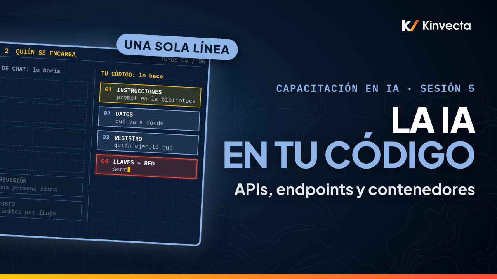

# Sesión 5 · APIs, endpoints y contenedores

  

**Duración:** 7:43 · **Para:** Quienes automatizan · **Versión en aula:** 90 minutos

Cuando tu propio software llama a un modelo de IA, no hay app de chat de por medio: los controles son de tu equipo. La Sesión 5 de la Capacitación en IA de Kinvecta explica qué cambia cuando el código llama al modelo por la API (la puerta por la que tu software llama al modelo), de dónde viene esa API y cómo un contenedor lo mantiene seguro. No necesitas programar.

## Vas a aprender

- Qué cambia cuando tu código llama al modelo: los seis trabajos que antes hacía la app de chat
- Las tres puertas de entrada al mismo modelo (API del proveedor, proveedor de nube y plataforma aprobada), y por qué primero se autoriza
- Cuatro hábitos para que cambiar de proveedor sea una sola línea: el endpoint en la configuración, la versión del modelo fijada, una sola forma de solicitud y la lista de permitidos
- Cómo un contenedor sella tu código, con una sola salida
- Los cuatro controles de ejecución: secretos en tiempo de ejecución, modelo fijado, registro de auditoría y límites de uso y de costo
- Por qué chat más una API ya lleva a la mayoría de los equipos a la Etapa 3

## La regla de oro

> **Llámalo desde tu código. Deja el endpoint en la configuración. Séllalo en un contenedor.**

Tu código se vuelve el arnés (en inglés, harness), así que los controles son de tu equipo.

## Ideas clave

- Cuando tu código llama al modelo por la API, tu software se vuelve el arnés. Los seis trabajos que hacía la app de chat ahora le tocan a tu equipo: instrucciones, manejo de datos, registro, llaves y red, revisión y límites de costo.
- Hay tres puertas de entrada al mismo modelo: la API del propio proveedor, la versión alojada en un proveedor de nube y la plataforma aprobada de tu organización. El modelo es el mismo; cambian los términos, la retención de datos y la aprobación.
- Elige primero la puerta, por sus términos y aprobaciones, y luego el modelo.
- Cuatro hábitos hacen que cambiar sea cosa de una línea: el endpoint en la configuración, la versión del modelo fijada, una sola forma de solicitud y una lista de permitidos con ese único endpoint.
- Todo arnés corre sellado en un contenedor con una sola salida: solo llega al endpoint aprobado del modelo y a los servidores de herramientas aprobados. Todo lo demás, incluidos los archivos de la propia computadora, se bloquea.
- Cada ejecución deja registro: secretos inyectados en tiempo de ejecución, un modelo fijado, un registro de auditoría y límites de uso y de costo.

## Términos clave

| Término | Qué significa |
|---|---|
| API | La puerta por la que tu software llama al modelo |
| Endpoint | La dirección a la que tu código manda las solicitudes |
| Llave de API | La credencial con la que tu código se identifica ante la API; nunca va escrita en el código |
| Tres puertas de entrada | La API del proveedor, la versión alojada en un proveedor de nube y la plataforma aprobada de tu organización |
| Plataforma aprobada (gateway) | La puerta de tu organización que pone varios modelos detrás de un solo acceso, con revisión, control de acceso y registro |
| Versión fijada | El nombre exacto de la versión del modelo en la configuración, para que no cambie sin que lo decidas |
| Contenedor | Una caja sellada con tu código y sus dependencias, que corre igual en cualquier lado y solo llega a donde le permites |
| Lista de permitidos | La lista de los únicos destinos de red a los que puede llegar el contenedor |
| Secretos en tiempo de ejecución | Llaves y contraseñas que un gestor de secretos inyecta al arrancar, en vez de guardarse en el código o en la imagen |
| Registro de auditoría | El registro de cada ejecución: qué entró, qué modelo se llamó, qué salió y quién lo revisó |
| Límites de uso y de costo | Los topes de solicitudes y de gasto que detienen una ejecución antes de que la factura sorprenda |

## Pruébalo

Un ejercicio de autoestudio de 15 minutos, basado en el ejercicio del video (capítulo 5:34). No necesitas programar.

1. **Léelo (7 minutos).** Abre la diapositiva del ejercicio en `slides.pdf`. Hay un pedazo corto de pseudocódigo que resume un documento. Encuentra cinco problemas. Las pistas están en la misma diapositiva; tápalas si quieres el reto. Si te atoras, repasa los seis trabajos que ahora son de tu código y los cuatro hábitos de la sesión.
2. **Enciérralo (6 minutos).** Para un flujo de trabajo semanal que resume contratos, dibuja el contenedor en blanco y llénalo: qué hay adentro, el único endpoint al que puede llegar, de dónde viene la llave, qué registra cada ejecución y su límite de uso y de costo.
3. **Cierra (2 minutos).** Si lo primero que encontraste fue la llave en el código, le pasa a casi todo el mundo. Anota qué cambiarías mañana en un script real de tu equipo.

## Pon a prueba lo aprendido

Las seis preguntas de repaso de la guía maestra. Intenta responder antes de abrir cada respuesta.

1. Cuando tu código llama al modelo en lugar de la app de chat, ¿de qué tiene que hacerse cargo tu equipo?
   

Respuesta
De los seis trabajos que hacía la app de chat: instrucciones (prompts guardados), manejo de datos, registro, llaves y red, revisión humana y límites de costo.

2. Nombra los tres tipos de endpoint.
   

Respuesta
La API del propio proveedor, la versión alojada en un proveedor de nube y una plataforma aprobada o gateway.

3. ¿Qué eliges primero, la puerta o el modelo, y por qué?
   

Respuesta
La puerta. El modelo es el mismo detrás de cada puerta; lo que cambia es el contrato: términos, retención de datos y aprobación.

4. ¿Por qué dejar el endpoint en la configuración?
   

Respuesta
Para que cambiar sea un cambio de una línea y la lista de permitidos de la red coincida con él.

5. ¿A qué puede llegar un contenedor?
   

Respuesta
Solo al endpoint aprobado del modelo y a los servidores de herramientas aprobados. Todo lo demás, incluidos los archivos de la propia computadora, se bloquea.

6. Nombra los cuatro controles de ejecución.
   

Respuesta
Secretos inyectados en tiempo de ejecución desde un gestor de secretos, versión del modelo fijada, registro de auditoría de cada ejecución y límites de uso y de costo.

## Para leer más

- [Generalidades del protocolo HTTP](https://developer.mozilla.org/es/docs/Web/HTTP/Overview), la explicación de MDN en español de cómo viaja una solicitud y su respuesta, la base de toda API
- [Configuración](https://12factor.net/es/config), el factor III de la metodología de doce factores, en español: el endpoint y las llaves viven en el entorno, no en el código
- [OWASP API Security Top 10](https://owasp.org/API-Security/) (en inglés), los diez riesgos más comunes al exponer y consumir APIs
- [Building best practices](https://docs.docker.com/build/building/best-practices/) (en inglés), la guía oficial de Docker: imagen base fijada, build multietapa y nada de secretos adentro
- [Docker Security Cheat Sheet](https://cheatsheetseries.owasp.org/cheatsheets/Docker_Security_Cheat_Sheet.html) (en inglés), la lista de OWASP para correr contenedores con el mínimo acceso

## Capítulos

- 0:00 Bienvenida: ¿de quién son los controles?
- 0:32 Lo que vas a poder hacer
- 0:54 Tres problemas que empiezan cuando el código llama al modelo
- 1:27 Con la API, tu código se vuelve el arnés
- 1:59 Seis trabajos que ahora son de tu código
- 2:30 Tres puertas de entrada al mismo modelo
- 3:07 Cuatro hábitos: el endpoint en la configuración
- 3:30 Sellado en un contenedor, con una sola salida
- 4:15 Los cuatro controles de ejecución
- 4:50 Lo que puedes hacer hoy
- 5:16 La regla de oro
- 5:34 Ejercicio: léelo y enciérralo
- 6:15 Pon a prueba lo aprendido
- 6:56 Lo que sigue: cómo construir flujos de trabajo (Sesión 6)
- 7:15 Para quien facilita: el sandbox de la Etapa 2

## En esta carpeta

| Archivo | Qué es |
|---|---|
| [`slides.pdf`](slides.pdf) | Las diapositivas del video, una página por diapositiva |
| [`transcripción/Sesión 5 - APIs, endpoints y contenedores - transcripción.txt`](transcripci%C3%B3n/Sesi%C3%B3n%205%20-%20APIs%2C%20endpoints%20y%20contenedores%20-%20transcripci%C3%B3n.txt) | La narración en texto, con los tiempos de cada capítulo |

Ve la serie completa en orden en la [lista de YouTube](https://www.youtube.com/playlist?list=PLPYZqM8a_06M). [Volver al curso](../README.md) · [English version](../../Session%205%20-%20APIs%2C%20Endpoints%20and%20Containers/)
