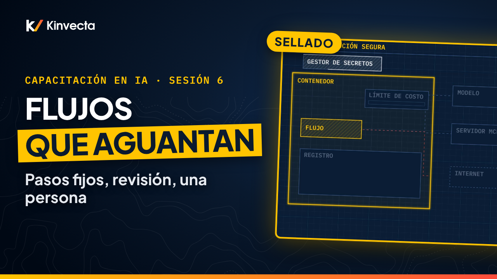

# Sesión 6 · Cómo construir flujos de trabajo

  

**Duración:** 8:20 · **Para:** Quienes automatizan · **Versión en aula:** 90 minutos

Pegas el mismo prompt cada lunes, el flujo se rompe y nadie se da cuenta, y no te aprueban agentes. La Sesión 6 de la Capacitación en IA de Kinvecta explica cómo convertir una tarea repetida en un flujo de trabajo: una ruta fija y segura, con una revisión de cada resultado y una persona que aprueba antes de entregar.

## Vas a aprender

- La diferencia entre un chatbot, un flujo de trabajo y un agente: ¿quién elige cada paso?
- Hasta dónde puedes llegar solo con chat y una API, sin agentes
- Las seis señales de un buen primer flujo de trabajo
- La anatomía de un flujo: disparador, entradas, prompt guardado, validación, revisión humana y entrega
- Cómo la validación detecta un resultado malo antes de que se entregue
- Cómo ejecutarlo con seguridad: contenedor, lista de permitidos, registros y límites de costo
- Cómo probar y dar versión a un prompt antes de liberarlo, y cómo medir si funciona
- La regla de oro: fija la ruta, revisa cada resultado y una persona aprueba antes de entregar

## La regla de oro

> **Fija la ruta. Revisa cada resultado. Una persona aprueba antes de entregar.**

## Capítulos

- 0:00 Bienvenida: tres lunes, una ruta fija
- 0:38 Lo que vas a poder hacer
- 1:03 Por qué importa: tres quejas comunes
- 1:34 ¿Quién elige cada paso? Chatbot, flujo y agente
- 2:18 Hasta dónde puedes subir con lo que tienes hoy
- 2:58 Elige tu primer flujo de trabajo
- 3:26 Anatomía de un flujo de trabajo
- 4:14 Validación: revisa cada resultado
- 4:49 Ejecución segura: sellado, registrado y con límites
- 5:22 Antes de liberar: pruébalo y dale versión
- 5:55 Mídelo: cuatro números
- 6:11 La regla de oro
- 6:27 Ejercicio: diséñalo y luego rómpelo
- 7:12 Pon a prueba lo aprendido
- 7:55 Lo que sigue: Herramientas, MCP e inyección de prompts (Sesión 7)

## En esta carpeta

| Archivo | Qué es |
|---|---|
| [`slides.pdf`](slides.pdf) | Las diapositivas del video, una página por diapositiva |
| [`transcripción/Sesión 6 - Cómo construir flujos de trabajo - transcripción.txt`](transcripci%C3%B3n/Sesi%C3%B3n%206%20-%20C%C3%B3mo%20construir%20flujos%20de%20trabajo%20-%20transcripci%C3%B3n.txt) | La narración en texto, con los tiempos de cada capítulo |

Ve la serie completa en orden en la [lista de YouTube](https://www.youtube.com/playlist?list=PLPYZqM8a_06M). [Volver al curso](../README.md) · [English version](../../Session%206%20-%20Building%20Workflows/)
