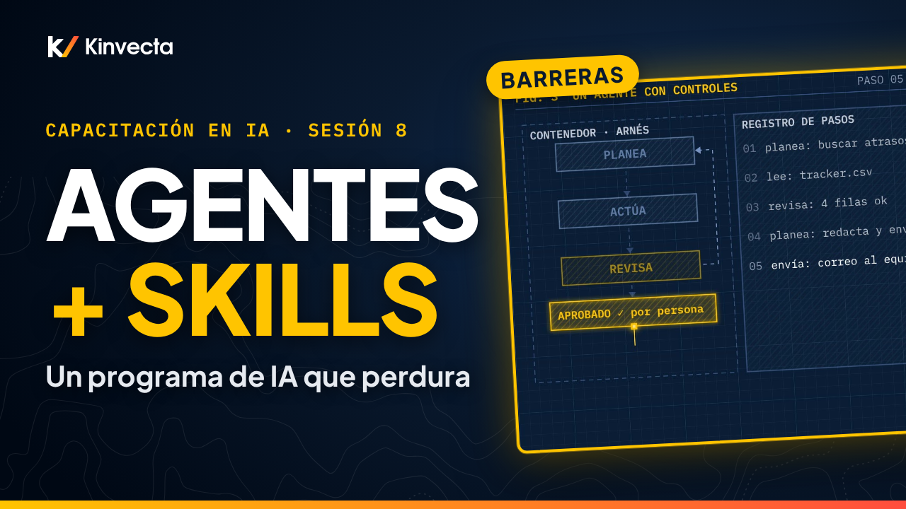

# Sesión 8 · Agentes, skills y cómo dirigir el programa

  

**Duración:** 8:17 · **Para:** Quienes automatizan y quienes dirigen · **Versión en aula:** 90 minutos

La capacitación solo funciona cuando el trabajo cambia. En la última sesión de la Capacitación en IA de Kinvecta juntamos las piezas: skills (paquetes de instrucciones que el modelo carga solo cuando los necesita), herramientas y un modelo trabajando como un solo trabajo repetible; agentes con barreras de seguridad; una biblioteca compartida de prompts y skills; y cómo desplegar el programa y demostrar que funcionó.

## Vas a aprender

- Qué es una skill, cómo se carga por capas y por qué sale barata
- Por qué cada skill se trata como código: léela, escanéala, fija su versión e instálala desde tu registro interno
- Cómo una skill, herramientas y un modelo se combinan en un trabajo repetible
- Cómo ponerle barreras a un agente: un contenedor, un registro de pasos y una persona que aprueba lo que sale
- Cómo un prompt guardado se vuelve una skill revisada y versionada en una sola biblioteca compartida
- Las cinco etapas de un programa de IA, el riesgo nuevo de cada una y dónde para cada rol
- Cómo medir si la capacitación funcionó: primero las líneas base, luego cuenta trabajo, no cursos
- La regla de oro: escríbelo una vez, como skill; controla lo que sale; mide lo que cambia

## La regla de oro

> **Escríbelo una vez, como skill. Controla lo que sale. Mide lo que cambia.**

El know-how se vuelve práctica compartida cuando se revisa, se prueba y se mide.

## Ideas clave

- Una skill es como una guía de inducción que la IA carga solo cuando la necesita. Al inicio solo se cargan los nombres y las descripciones, así que puedes instalar docenas sin gastar mucho. Una descripción vaga significa una skill que nunca se activa.
- Trata cada skill como código: léela, escanéala, fija la versión, instálala desde un registro interno y decide quién puede instalar.
- Una skill aporta el método, las herramientas aportan datos y acciones, y el modelo llena los huecos con criterio. Juntos forman un trabajo repetible.
- Un agente corre en un contenedor, registra cada paso y espera en el punto de control hasta que una persona aprueba todo lo que sale: enviar, guardar de regreso o cambiar un registro. Revisa los pasos, no solo la respuesta.
- Las personas aprenden en cinco etapas y cada etapa agrega un riesgo nuevo. Todos empiezan en la Etapa 1; los líderes se quedan ahí con una demostración del resto, los analistas llegan a la Etapa 3 y el personal técnico a la Etapa 5.
- La capacitación funcionó cuando el trabajo cambió: toma líneas base primero y luego mide el tiempo ahorrado, los errores detectados, el reúso de la biblioteca y los flujos en producción. Cuenta trabajo, no cursos.

## Términos clave

| Término | Qué significa |
|---|---|
| Skill | Un paquete de instrucciones, plantillas y archivos que el modelo carga solo cuando lo necesita |
| Carga por capas | Primero solo nombre y descripción; las instrucciones completas y los archivos se cargan cuando una solicitud coincide |
| Registro interno (de skills) | El lugar aprobado de tu organización desde donde se instalan skills ya leídas, escaneadas y con versión fijada |
| Agente | La IA elige los pasos en tiempo de ejecución, dentro de un contenedor, con registro y puntos de control |
| Barreras de seguridad | Los límites que rodean a un agente: contenedor, lista de permitidos, registro de pasos y aprobación humana |
| Punto de control | El paso en el que el agente se detiene hasta que una persona aprueba una acción que sale del sistema |
| Biblioteca compartida | El lugar único, con control de versiones, donde viven los prompts y las skills del equipo |
| Las cinco etapas | 1 uso diario seguro, 2 la API en un contenedor, 3 flujos de trabajo fijos, 4 llamada a herramientas, 5 agentes y skills |
| Línea base | La medida de la tarea antes de la capacitación, para poder comparar después |
| Piloto | Un primer despliegue acotado, con un flujo, roles definidos, tres medidas y una fecha para revisar los números |

## Pruébalo

Un ejercicio de autoestudio de 20 minutos, basado en el ejercicio del video (capítulo 6:05). Solo necesitas papel.

1. **Empaquétalo (10 minutos).** Toma tu prompt de la Sesión 3 y ponle nombre. Escribe una descripción de una o dos líneas que diga cuándo usarlo. Luego escribe tres solicitudes que deberían activarlo y dos que no. Léelas solo contra la descripción, como lo haría el modelo: ¿acierta las cinco? Si no, ajusta la descripción hasta que lo haga. De tarea, agrega la plantilla y los casos de prueba.
2. **Planea el despliegue (8 minutos).** Para un piloto real, anota cuatro cosas: el flujo de trabajo; qué roles llegan a qué etapa; tres medidas con sus líneas base; y la fecha en que vas a revisar los números.
3. **Cierra (2 minutos).** Si alguna de tus medidas cuenta cursos en lugar de trabajo, cámbiala.

## Pon a prueba lo aprendido

Las seis preguntas de repaso de la guía maestra. Intenta responder antes de abrir cada respuesta.

1. ¿Qué se carga antes de que se active una skill?
   

Respuesta
Solo el nombre y la descripción de cada skill, unos 80 tokens cada una.

2. ¿Qué etapa completan todos y dónde paran los analistas?
   

Respuesta
Todos completan la Etapa 1. Los analistas paran en la Etapa 3.

3. ¿Qué aporta cada uno: una skill, las herramientas y un modelo?
   

Respuesta
La skill aporta el método, las herramientas aportan datos, acciones y revisiones, y el modelo aporta criterio en los huecos.

4. ¿Dónde tiene que aprobar una persona el trabajo de un agente?
   

Respuesta
Antes de que cualquier acción salga del sistema: enviar, guardar de regreso o cambiar un registro.

5. ¿Qué hace que un prompt esté listo para la biblioteca?
   

Respuesta
Un archivo de texto plano con encabezado, la revisión de otra persona, una versión y casos de prueba que pasa.

6. Nombra dos medidas que muestren que la capacitación funcionó.
   

Respuesta
Dos de estas: tiempo ahorrado por tarea, errores detectados en revisión, reúso de la biblioteca, flujos en producción, hallazgos de seguridad.

## Para leer más

- [Agent Skills](https://agentskills.io/) (en inglés), el formato abierto de skills: una carpeta con `SKILL.md`, carga por capas (descubrimiento, activación, ejecución) y reúso entre arneses
- [Building effective agents](https://www.anthropic.com/research/building-effective-agents) (en inglés), cuándo conviene un agente, cuándo basta un flujo de trabajo y por qué empezar simple
- [Agentic AI: Threats and Mitigations](https://genai.owasp.org/resource/agentic-ai-threats-and-mitigations/) (en inglés), la guía de OWASP sobre las amenazas propias de los agentes y sus controles
- [Top 10 2025 de riesgos y mitigaciones para LLMs y aplicaciones de IA generativa](https://genai.owasp.org/resource/top-10-2025-de-riesgos-y-mitigaciones-para-llms-y-aplicaciones-de-ia-generativa/), la traducción oficial de OWASP al español; mira LLM06 (agencia excesiva) y LLM03 (cadena de suministro)

## Capítulos

- 0:00 Bienvenida: juntamos las piezas
- 0:26 Lo que vas a poder hacer
- 0:50 Tres formas en que se estancan los programas de IA
- 1:25 Cómo se carga una skill por capas
- 1:59 Trata cada skill como código
- 2:27 Skill + herramientas + modelo: un trabajo repetible
- 3:14 Agentes con barreras
- 3:51 Una biblioteca compartida de prompts y skills
- 4:19 Cinco etapas, un riesgo nuevo en cada una
- 5:11 Cómo medir lo que cambió
- 5:52 La regla de oro
- 6:05 Ejercicio: empaquétalo y planea el despliegue
- 6:53 Pon a prueba lo aprendido
- 7:32 Serie completa: tu siguiente paso

## En esta carpeta

| Archivo | Qué es |
|---|---|
| [`slides.pdf`](slides.pdf) | Las diapositivas del video, una página por diapositiva |
| [`transcripción/Sesión 8 - Agentes, skills y cómo dirigir el programa - transcripción.txt`](transcripci%C3%B3n/Sesi%C3%B3n%208%20-%20Agentes%2C%20skills%20y%20c%C3%B3mo%20dirigir%20el%20programa%20-%20transcripci%C3%B3n.txt) | La narración en texto, con los tiempos de cada capítulo |

Ve la serie completa en orden en la [lista de YouTube](https://www.youtube.com/playlist?list=PLPYZqM8a_06M). [Volver al curso](../README.md) · [English version](../../Session%208%20-%20Agents%2C%20Skills%20and%20Running%20the%20Program/)
